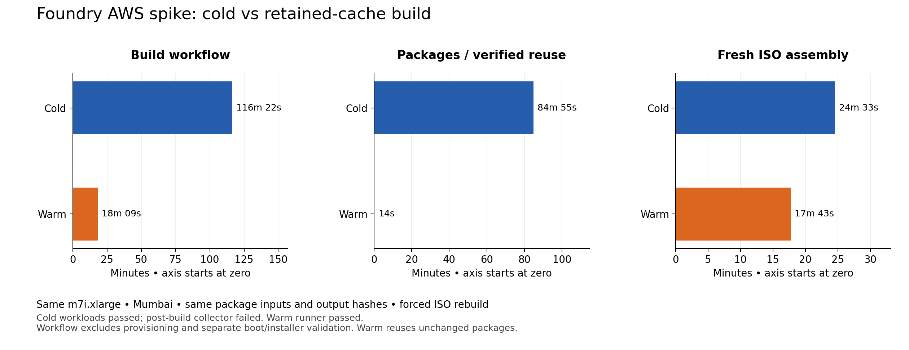
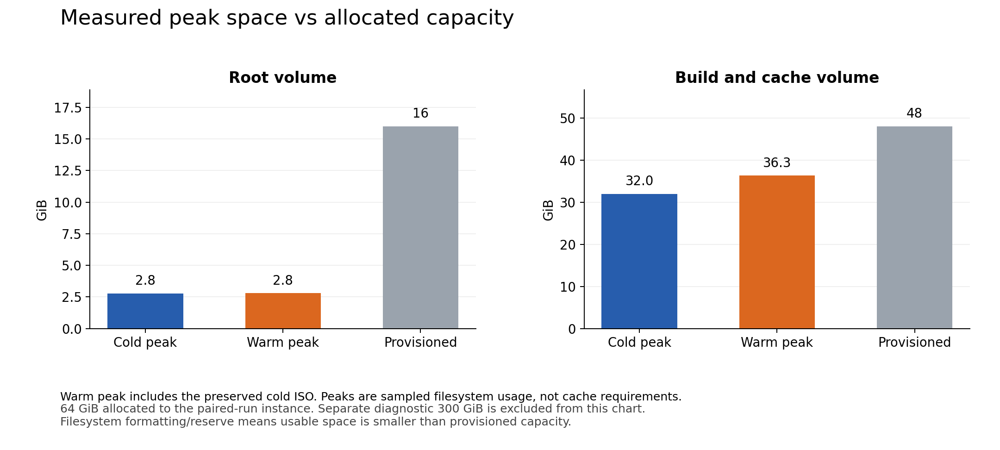
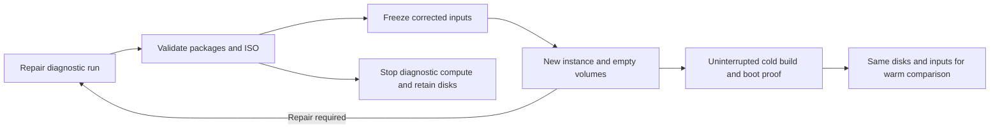
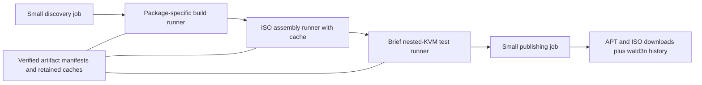
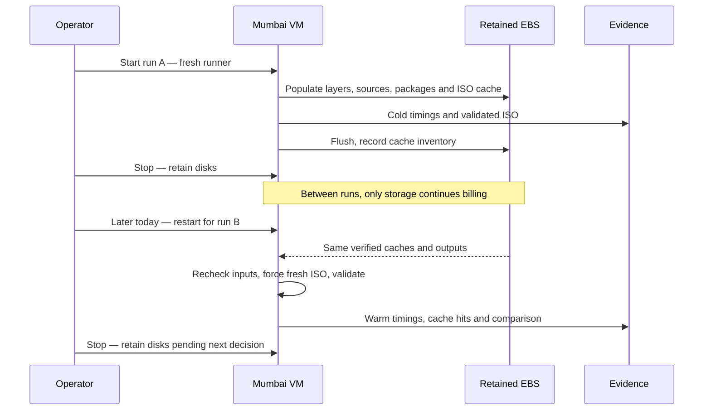
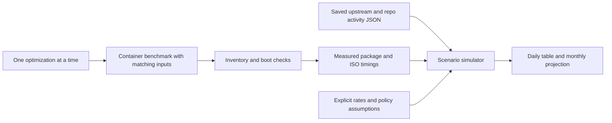

# AWS Mumbai spike: cold build, then warm build on the same disk

**Date:** 2026-11-15
**Status:** Diagnostic package/ISO build and desktop/installer launch passed; its instance is stopped with disks retained. A separate empty-volume cold run completed all 63 expected packages and ISO assembly without build intervention. Its post-build inventory collector failed because the ISO builder removes the staging chroot. This is a cold workload success, **not an error-free end-to-end runner pass**. The ISO inventory was recovered from the artifact; cold desktop boot and installer launch are visually verified; warm build, inventory comparison, desktop boot and installer launch passed. Both EC2 instances are confirmed stopped; all four disks are retained.
**Related:** [Daily publication plan](2026-11-15-daily-packages-and-iso.md) · [30-day activity and cost simulation](2026-11-15-daily-build-cost-history.md).

## Daily cost and the 4-GiB trial

Replaying the previous 30 complete Bangkok days of upstream and repository activity gives **$10.46 for 30 daily runs ($0.35/day)**, starting with empty artifact retention, or **$12.07 per 30 days once retention is full**. Publication uses same-region S3 with $0 transfer; public downloads and request fees are additional traffic-dependent costs. See the [daily table, graph, saved JSON and reusable simulator](2026-11-15-daily-build-cost-history.md).

| 4-GiB build runtime versus measured baseline | Total for the first 30 days | Monthly decrease |
|---|---:|---:|
| Same runtime | $9.26 | **$1.20 (11.5%)** |
| 50% longer | $9.72 | **$0.74 (7.1%)** |
| Twice as long | $10.18 | **$0.28 (2.7%)** |

These compare Mumbai c7i.large build stages with the measured m7i.xlarge rates, including public IPv4. Validation and control stages keep the larger-host rate. Storage and uploads are unchanged, so the absolute decrease also applies with full artifact retention. Break-even is about 2.30× build runtime, before extra host transitions or transfers. A successful trial must establish both correctness and actual runtime; simply avoiding an out-of-memory failure does not establish savings. The next AWS run remains deferred until 2026-11-16 and is not automatically scheduled.

## Measured results — graphs





[Timing graph (SVG)](assets/aws-spike-2026-11-15/timings.svg) · [Storage graph (SVG)](assets/aws-spike-2026-11-15/storage.svg) · [Measured data](assets/aws-spike-2026-11-15/measurements.json). Regenerate with `scripts/aws-spike/plot-results.py` in a Python container with Matplotlib. These charts use measured stage durations and sampled peaks; they do not invent a time series from summary data. Raw one-second counters remain on retained EBS. Cold workloads passed but the post-build collector failed; warm's corrected runner passed.

## Question and outcome

Measure how long the actual package-and-Anvil pipeline takes on AWS, then how much faster it becomes with persistent caches. **Four hours/day was a sensitivity assumption, not a forecast.** Replace it with measured cold and warm timings before choosing the daily schedule’s budget or machine size.

Will requested a fresh AWS run and a second run on the same retained disk; both workload measurements are now complete. Use Mumbai (`ap-south-1`), not Singapore. The home lab is not set up and must not be a dependency. This spike produces validated candidate artifacts and timings; enabling the daily scheduler and publishing production updates remain separate steps in the parent plan.

## Experiment design

| Run | Actual starting state | Result | Remaining qualification |
|---|---|---|---|
| Diagnostic | Fresh initial VM, repaired in place; 40 + 260 GiB disks | 63 binaries, ISO, desktop and installer launch passed; stopped | Repair time is not clean-build evidence |
| A: cold workloads | Separate fresh VM and empty 16 + 48 GiB disks | Packages 84m 55s; ISO 24m 33s; desktop and installer launch passed | Post-build inventory collector failed; whole runner exit 1 is preserved |
| Between runs | Confirmed stop/restart, same retained disks and package hashes | Cache and inputs retained | No cache pruning or restored diagnostic artifacts |
| B: warm | Same instance/disks and workload inputs; corrected evidence collector | Package verification 14s; fresh ISO 17m 43s; desktop/installer passed; runner exit 0 | Collector change documented separately from unchanged workload inputs |
| Next trial — 2026-11-16, not automatically scheduled | Optimizations prepared with container checks; proposed 4-GiB build host | Pending; no new AWS build today | Prove complete corrected runner, validate outputs, measure memory pressure/runtime; validation host separate |

### Clean cold proof gate (Will’s additional requirement)

- [x] Finish the diagnostic package build, ISO assembly and real UEFI desktop/installer checks.
- [x] Freeze and publish corrected runner/recipe inputs; record commit IDs and patch hashes.
- [x] Stop the diagnostic instance and preserve both of its disks and caches.
- [x] Launch a separate instance with newly created empty root/build volumes from the recorded standard OS AMI. Do not restore diagnostic snapshots, Docker layers, Foundry packages or ISO artifacts.
- [x] Capture new instance/volume IDs, empty cache inventories, launch/bootstrap timestamps and resource counters before workloads start.
- [x] Complete cold package and ISO workloads without interventions; capture actual desktop/installer evidence and artifact hashes. The later collector error is separate and remains recorded.
- [ ] Repeat an error-free end-to-end cold runner with the corrected collector; current cold runner exit 1 is not a full pass.
- [x] Complete the matched warm workload comparison using retained disks and matching package inputs; document the post-build collector correction.



Review state: `DIAGNOSTIC → INPUTS FROZEN → EMPTY VOLUMES VERIFIED → COLD BUILD PASS → BOOT/INSTALLER PASS → WARM COMPARISON`. Each transition requires its corresponding receipt; a successful repaired build cannot advance directly to cold proof.

Keep diagnostic elapsed time and estimated charges, successful stage timings, clean cold totals and warm totals separate. GNU `time` around Docker measures useful wall time but its CPU/RSS describe the client, not the container workload. Use host and cgroup counters for resource claims. The diagnostic raw recorder started after package compilation began, so its coverage is partial; do not present observed peaks as full-run peaks. Charge calculations from rates and running intervals are estimates, not an AWS invoice. The existing diagnostic disks total 300 GiB and cost $27.36 per month at the recorded gp3 rate. The paired-run instance used 64 GiB (16 root + 48 build), selected from measured peaks; its retention costs $5.84/month separately. Stop compute after use.

For run A, use the current package set invoked by the existing full-build workflow; do not silently substitute only PowerDevil or download published Foundry binaries and call that a complete source rebuild. Classify upstream binary-repack packages honestly. Record any recipes that restore prebuilt outputs remotely. If this full bootstrap is much larger than a normal daily update, report that distinction using stage timings rather than treating its total as the daily forecast.

For run B, reuse packages only when source, recipe, patches, architecture and builder inputs match. Existing `build-all.sh` shortcuts often key on changelog version and file presence; capture a stronger input/artifact manifest for the experiment so a same-version source edit cannot create a false cache hit. Never report “ISO already exists” as a fast warm build. Also record the time for the separate no-change discovery check; it is not the full-ISO time.

Pin the Git revisions, container digests and source payload checksums for both runs. Refresh authenticated APT metadata for health, but use the same recorded package versions or a retained package snapshot for the controlled comparison. If upstream package availability prevents identical inputs, label the differences and the comparison’s limitation instead of claiming a clean benchmark. No upstream version bumps are required for this cache experiment.

## Resource selection by stage

Will clarified that different stages should be free to use different service offerings. Do not assume the pipeline is CPU-bound or make the initial measurement runner the permanent architecture. Capture CPU utilization, peak RAM, disk IOPS/throughput/wait, network bytes, cache-hit rates, startup overhead and elapsed time separately for every stage.

| Stage | Candidate execution environment | Evidence that selects it |
|---|---|---|
| Discovery | Small scheduled container/job | Runtime, API/network demand and dependency footprint |
| Package builds | Containers on EC2 or an EC2-backed batch service, sized per package | Compile CPU, peak memory, cache hits and cost per successful package |
| ISO assembly | Container-capable EC2 runner with retained cache disk | Download, unpack/configuration, initramfs, disk I/O and compression timings |
| Desktop/installer test | Brief nested-KVM EC2 runner | Minimum comfortable host/guest RAM, real boot readiness and duration |
| Signing/publication/site update | Small isolated publishing job | Upload throughput, credentials and deployment runtime |

These are candidates, not claims that every service supports privileged live-build or nested KVM. Validate each requirement before selecting a managed offering. Discovery and publication do not need the build runner's memory or KVM. A T3 is not selected; burst credits and throttling must be included if it is benchmarked.

The first cold/warm pair may run stages sequentially on one instrumented EC2 VM to avoid confusing cache effects with hardware changes. That is an experimental control, not the daily architecture. After the matched pair, replay the expensive stages on smaller or different offerings using the same inputs. Select by total cost per validated output, including startup, transfer, persistent storage and operational complexity. Do not split stages merely to draw more boxes.



Pass immutable artifacts with checksums and input fingerprints between stages. Keep EBS caches with their owning build stage. An ordinary gp3 volume is not a shared multi-writer filesystem: detach/reattach only after clean unmount in the same AZ, or copy verified artifacts through object storage/private transfer. Count duplicate storage and transfer overhead. Keep both requested runs on the same retained disks; any hardware comparison is separately labelled.

## Runner and storage

The completed cold/warm baseline used **m7i.xlarge: 4 vCPUs, 16 GiB RAM**, nested virtualization, and **16 GiB root + 48 GiB build/cache**. The earlier diagnostic instance used 40 + 260 GiB. Both are stopped and their disks remain retained. Next, implement the reviewed optimizations and test a **4-GiB build host on 2026-11-16**, keeping the 4-GiB validation guest on a sufficiently larger host. No new AWS build will start today and tomorrow's test is not automatically scheduled. No 4-GiB performance or reliability claim has been established.

| Paired-run allocation | Provisioned | Cold sampled peak used | Warm sampled peak used |
|---|---:|---:|---:|
| OS/root | 16 GiB | 2.8 GiB | 2.8 GiB |
| Build workspace and caches | 48 GiB | 32.0 GiB | 36.3 GiB |
| Total provisioned | **64 GiB** | Peaks are per-filesystem, not simultaneous totals | Warm includes the preserved cold ISO |

The separate diagnostic 300-GiB allocation was an initial capacity allowance, not a production cache requirement. Useful retained cache content, transient build space and published artifact retention are separate costs. Do not automatically retain obsolete outputs as production caches.

AWS bills provisioned capacity, including unused space. Record peak used bytes separately from capacity, filesystem reserve and available bytes. Retain the current experimental disks as requested; select production cache retention and capacity from measured reusable content, rather than all generated data.

The paired-run instance uses 16 GiB root + 48 GiB build/cache; the stopped diagnostic retains its separate 40 + 260 GiB. Mount the build volume at `/srv/foundry-build` by filesystem UUID. Set **DeleteOnTermination=false on both volumes**, tag them with the spike/run owner, and make the stop/cleanup workflow explicitly retain them. Stop the instance between and after runs; do not terminate it, run `terraform destroy`, prune caches, or delete the volumes. Disk retention is intentional and billed until a later decision.


Use an automatically assigned IPv4 address, no inbound security-group rules, and SSM for management. Bootstrap pinned container images from an accessible verified source/export; the home-lab registry is unavailable. Keep downloaded images and build caches on the retained disk. Record the one-time bootstrap separately, but include it in the cold end-to-end total.

| Persisted data | Actual baseline location | Reuse rule |
|---|---|---|
| Docker/containerd image stores | `/srv/foundry-build/docker` and `/srv/foundry-build/containerd` | Verified image IDs; preserved across stop/start |
| Package-manager downloads | `/srv/foundry-build/cache/{apt,npm,pnpm,yarn}` | Download integrity checks remain required |
| Package outputs and manifests | `/srv/foundry-build/source/foundry-apt/dist`, `/srv/foundry-build/packages-cache.json` | Baseline verifies complete unchanged input/output hashes |
| Live-build download cache | `/srv/foundry-build/source/foundry-iso/cache` | Downloads retained; root and ISO regenerated |
| Logs, receipts and ISO artifacts | `/srv/foundry-build/runs/{cold,warm,cold-boot,warm-boot}` | Cold/warm evidence kept separately |
| Compiler cache and finer source-cache policy | Optimization implementation in progress | Not part of the measured baseline; validate before claiming reuse |

Map these stores into the existing recipes rather than assuming proposed directory names automatically enable caching. Audit source scripts for cleanup that discards downloads or useful outputs. Fresh live-build roots still need package unpack/configuration, initramfs generation and filesystem compression; caching downloads cannot remove those costs. Do not resume a partial build by invoking `lb bootstrap` over a configured root: the earlier local attempt showed that it can restore the base cache and discard the installed desktop.

## Dated agenda

### 2026-11-15 — completed baseline

- [x] Selected `wf-terraform`, Mumbai, verified Ubuntu AMI and nested KVM, and installed scoped stop guards.
- [x] Recorded new empty-volume inputs and separate provisioning/workload clocks.
- [x] Built all expected packages and Anvil without workload repair on the fresh instance.
- [x] Recovered ISO inventory after the collector error; visually verified desktop and installer launch.
- [x] Stopped/restarted the same instance and retained disks; verified unchanged package-cache hashes.
- [x] Forced a warm ISO rebuild and repeated desktop/installer checks; corrected runner exited 0.
- [x] Saved measurements and stopped compute; all four experimental disks retained.
- [ ] Finish optimization implementation and local container checks; update the reusable 30-day cost simulation. No new AWS build today.

### 2026-11-16 — next trial, not automatically scheduled

- [ ] Run the optimized build on a 4-GiB host with explicit compile/compressor limits.
- [ ] Measure anonymous memory, reclaim pressure, swap/OOM events, CPU time, runtime and cost per completed artifact; use 8 GiB as a fallback comparison if needed.
- [ ] Complete error-free cold-run proof with the corrected collector and validate both desktop and installer on a sufficiently larger KVM host.
- [ ] Feed measured optimized timings into a separate simulation scenario; preserve the current baseline.

### Separate remaining measurements

- [ ] No-change discovery latency, changed-source compiler-cache hit rates, signing/upload time and actual publication bytes.
- [ ] Full disk installation if added to the validation scope; current tests prove desktop and installer launch only.

## Run controls and review screen

The following Task entry points are proposed, not commands that already exist. Implement them through the repository’s normal container runner and infrastructure workflow before execution.

```text
AWS build spike — Mumbai
  Runner:        configurable baseline m7i.xlarge / 4 vCPU / 16 GiB
  Stage sizing:  measure separately, choose offerings after A/B
  Input:         <Git SHA> / <builder digest> / <package snapshot>
  Run A:         workloads passed; collector exit 1 recorded
  Run B:         passed — fresh ISO, verified retained inputs
  Next trial:    2026-11-16 — 4 GiB builds, not scheduled
  Retention:     KEEP root, build disk, container layers and caches
  End action:    STOP instance
  Daily timer:   DISABLED

  Review AWS resources  -> task spike:plan
  Run cold benchmark    -> task spike:run MODE=cold
  Stop and retain disk  -> task spike:stop
  Run warm benchmark    -> task spike:run MODE=warm
  Compare evidence      -> task spike:report
```



## Measurement and interpretation

| Metric | Cold A | Warm B |
|---|---|---|
| Stack-base / build / deb / project-builder | 34s / 57s / 49s / 4m 17s | Cached; four stages completed within the same recorded second |
| Package work / verified reuse | 84m 55s; all 63 expected binaries | 14s; unchanged artifact hashes |
| ISO assembly | 24m 33s | 17m 43s |
| Initramfs generations observed in ISO log | 6 | 6 |
| Desktop and installer launch | Visually verified | Visually verified |
| Sampled build-disk peak | 32.0 GiB | 36.3 GiB, including preserved cold ISO |
| Package-container sampled anonymous-memory peak | 3.16 GiB | No compilation; artifact reuse |
| ISO-container sampled anonymous-memory peak | 2.53 GiB | 2.51 GiB |
| Runner start to finish, excluding provisioning/VM validation | 1h 56m 22s; exit 1 after build at collector | 18m 09s; exit 0 |
| Installed ISO package versions | 2,812 installed | Same 2,812 versions; no differences |
| Download bytes and detailed substage timings | Raw counters/logs retained; not fully analyzed | Raw counters/logs retained; not fully analyzed |
| Full disk installation / publication | Not tested | Not tested |

Report `cold_seconds / warm_seconds` for comparable stages and the whole pipeline. Do not mix provisioning with steady-state timings or infer speedup from differing package sets. Two runs establish a baseline, not a statistical reliability guarantee. Production signing, upload and live wald3n verification are not measured by this build-only spike; include an explicit remaining allowance and measure those stages before setting the production budget.

Success means both ISOs pass the same real boot/installer checks, warm cache hits are demonstrable, and the second run rebuilds its ISO. If warm time is still dominated by root setup or compression, report that and propose a focused optimization. There is no assumed “very quick” threshold to manufacture a pass.

## Spike costs and retention

The measured instance rate is **$0.2121/hour compute + $0.005/hour public IPv4 = $0.2171/hour**. Rates are recorded in the pricing evidence and model inputs; interval charges below are estimates, not AWS invoices.

| Cost item | Per day (30-day convention) | Per 30 days | Scope |
|---|---:|---:|---|
| Paired-run retained 64-GiB EBS | $0.195 | $5.84 | Current candidate build capacity, billed while stopped |
| Separate diagnostic retained 300-GiB EBS | $0.912 | $27.36 | Temporary historical experiment, excluded from daily production simulation |
| All disks currently retained | **$1.107** | **$33.20** | No disks deleted |
| Unchanged warm workflow compute/IP, once daily | $0.066 | $1.97 | 18m 09s each day; excludes changed-package builds, startup, validation, publication and transfers |

The once-daily total must also account for upstream activity and artifact publication. The [30-day history simulation](2026-11-15-daily-build-cost-history.md) provides the daily table and breakdown from saved activity, measured recipe times and explicit scenario assumptions. It separates free same-region S3 publication, public download traffic, retained EBS and S3 artifact storage. A smaller instance or optimized runtime is not substituted until measured or explicitly labeled a hypothetical scenario.

No production artifacts were uploaded during the spike. Both instances are stopped; disks remain as requested. Production scheduling stays disabled. Retained storage costs continue until a later retention decision; nothing is deleted automatically.

## Deliverables

- [ ] Git-managed AWS CLI runner scripts, exact resource-ID receipts and runnable cold/warm/stop/report entry points; Terraform is unnecessary for this temporary spike.
- [ ] Stage-by-stage resource profiles and a comparison of candidate service offerings, including artifact handoff costs.
- [x] Input/artifact manifests, cache inventories, timing/resource data and private instance/volume receipts saved.
- [x] ISO desktop and installer-launch screenshots for both runs.
- [ ] A comparison report replacing the parent plan’s four-hour budgeting assumption with measured data and stated publication overhead still to measure.
- [x] Both EC2 instances stopped; all four disks retained; daily scheduler disabled.

AI assistance: Codex CLI 0.169.0; model gpt-6-astra; reasoning effort medium, verified from session metadata.

## Historical execution journal

The following dated checkpoints preserve what was known at the time. Current results, tables and remaining work are above; historical “pending” statements below are not the current status.

### Execution preparation — 2026-11-15

- [x] AWS wf-terraform identity verified; Mumbai M7i nested virtualization and Canonical Ubuntu 26.04 AMI checked.
- [x] Added [launch controller](../../scripts/aws-spike/launch.py), [host bootstrap](../../scripts/aws-spike/bootstrap.sh), and [measurement runner](../../scripts/aws-spike/run.sh). Launch payload fits EC2 user-data; Python syntax checked in the pinned test container and shell scripts pass bash syntax checks.
- [x] Launch and record instance/volume IDs in the private receipt `/home/will/powerdevil-upgrade/aws-spike/resources.json`.
- [ ] Finish diagnostic package/ISO stages, then run the separate measured UEFI desktop/installer validation.

The launcher creates only a dedicated security group, SSM instance role/profile, runner with retained volumes, and a scoped deadline role/schedule in the existing default VPC. It records every created resource and stops a launched instance if later provisioning fails. No signing or production publication credentials are sent to the runner. The automatic build service stops the instance after build success or failure; test and warm-run starts are explicit.

## Live diagnostic run — 2026-11-15

Runner `i-09ed2b15f19ac5b71`, m7i.xlarge, ap-south-1a, launched at 11:58 Bangkok. Root volume `vol-0926caa68cf02bb0f` and build/cache volume `vol-00d37a922a21b2381` both have DeleteOnTermination=false. Nested virtualization is enabled; cloud-init completed and the cold-run service is active. Independent stop deadline: 19:58 Bangkok. Build inputs: Foundry `96906db229416a053959db58d43f54471336b0dc`, home-lab stacks `a0d9ec5279b5f63662889f3db1153284aed752ea`. No production publication is part of this spike.

### Diagnostic setup correction and early observations

Docker uses the containerd snapshotter on this Ubuntu image. Docker's data-root setting alone left its image/layer store under `/var/lib/containerd` on the 40 GB root volume. The cold run was stopped, all existing containerd data moved to the retained build volume and bind-mounted back, and the retained package container resumed. No cache was pruned. The bootstrap script now handles this store before starting a new run. Original logs survive in `runs/cold-before-storage-fix` and `runs/cold-before-resume-fix`; setup correction time must remain separate from package/ISO timings.

Observed initial stages: host bootstrap 38 seconds, base stack 38 seconds, build stack 71 seconds, packaging stack 54 seconds, project package-builder layer 191 seconds. On the interrupted-run restart, these image builds reused their layers in approximately one second total. This confirms image-layer reuse only; it is not the warm A/B result. Source packages including drmon and f9dasm passed; the full package set and ISO remain in progress. Early preparation samples were mostly idle and used little memory, so resource sizing remains unproven.

### Recipe repairs under validation

The diagnostic package pass failed Flycast because tinygettext’s nested tinycmmc checkout was absent. The spike includes Will’s existing nested-submodule correction as an explicit hashed patch without staging unrelated working-tree changes. RPCS3’s generated build-dependency helper was removed by APT instead of switching the conflicting curl development package. A direct `apt-get -s build-dep` simulation resolves the dependencies by replacing the GnuTLS development variant with OpenSSL; the spike patch uses direct source build-dependency resolution. Both actual builds still need to pass before corrected inputs are frozen.

New-run instrumentation records raw host and container cgroup counters from bootstrap and build startup, preserves attempt logs, and refuses an existing package container as clean cold input. Warm package reuse requires an exact recipe/builder fingerprint and hashes of every retained output; it remains separate from a forced ISO rebuild.

### Local package preference

Will requested making local-candidate preference permanent. ISO staging now retains the newest available local build of each package even when the public repository has the same version. The install hook explicitly reinstalls selected local files and retains the edition dependency filter, so Atelier-only candidates do not enter Anvil. This removes the preliminary published-version fetch/filter; it does not claim that every earlier live-build dependency download is eliminated. Diagnostic execution initially used an equivalent patch; the clean proof will use the committed permanent change.

### Diagnostic checkpoint — 13:20 Bangkok

Flycast passed after its nested-submodule repair. RPCS3 passed dependency installation and source preparation and is compiling. The independent binary-inventory audit found 62 of 63 expected binaries with matching Debian package name, version and architecture; only the in-progress RPCS3 binary is missing. ISO assembly, VM validation, clean cold proof and warm comparison are still pending. The permanent local-package preference passed an isolated Ubuntu container test: same-version files were replaced from the local archive with zero archive download, and an Atelier candidate was excluded from Anvil.

### Diagnostic supervision interruption — 13:19 Bangkok

The host’s unattended upgrader updated libc and restarted transient services. It stopped the diagnostic controller, whose restart then rejected its existing run directory. The package container itself continued compiling RPCS3; Docker reported it running and not OOM-killed. The controller’s `exit-code` file contained zero from its termination trap and must not be interpreted as successful package completion. Host APT history and journal entries identify the interruption.

Supervision continues in `runs/diagnostic-continuation`, with Docker log timestamps covering the detach interval and an explicit `docker wait` plus container-exit check. Periodic APT timers are disabled for this temporary benchmark; the corrected bootstrap does this before workloads start and lists rather than automatically restarts services during bootstrap package installation. Interrupt signals now produce nonzero runner exits. Fresh cold attempts also reject an existing source tree, image, container or populated download cache. Host kernel and installed-package inventories are retained for comparison. This remains diagnostic evidence, not clean cold timing.

### Diagnostic package completion — 13:52 Bangkok

- [x] All 63 expected binary packages exist with the required package names, versions and architectures; the independent inventory audit reports no missing binaries.
- [x] Flycast and RPCS3 completed after their recorded recipe repairs.
- [x] A diskless nested-KVM guest ran until the deliberate three-second timeout; this is infrastructure preflight, not ISO validation.
- [ ] ISO assembly is in progress, starting with base-system download, validation and configuration.
- [ ] Actual ISO desktop/installer validation, clean cold proof and warm comparison remain pending.

After package-build scratch cleanup, the build filesystem used about 9.4 GiB, down from an observed 17 GiB near package completion. These observations do not yet include the ISO-stage peak. The completed inventory is retained at `runs/diagnostic-continuation/package-inventory.json` on the runner and copied with SHA256 verification to `/home/will/powerdevil-upgrade/aws-spike/evidence/package-inventory-63-of-63.json`.

### Same-version preference and frozen-input downgrades

The diagnostic ISO hook reinstalled 25 same-version packages but also selected six older frozen local builds: foundry-core, halfempty, powerdevil, tilemap-studio and xemu/xemu-xbox. The permanent default now skips local versions older than the installed repository version and does not permit implicit APT downgrades. Same-version local replacement remains enabled. An explicit spike patch sets `FOUNDRY_ALLOW_OLDER_LOCAL=1` so the controlled cold/warm comparison tests its frozen source inputs even when publication has advanced. This is candidate validation, not production publication. An isolated Ubuntu container test passed same-version replacement, default rejection of older local builds, and the explicit controlled override.

### Diagnostic validation complete; fresh proof sizing

The diagnostic ISO finished at 14:16:39 Bangkok with exit code 0. ISO assembly took **25 minutes 32.75 seconds**; this is wall time, not Docker-client CPU/RSS. The 4.5-GiB candidate SHA256 is `1b4222ffd96a97ac8d6da6e5d9c3489a1c40c1637b59c779c6436181e4cc7e76`. The instance then stopped automatically and was restarted for VM validation.

A 2-vCPU, 4096-MiB offline UEFI/KVM guest displayed the Foundry desktop and welcome window. Its desktop screenshot was captured at 14:28:14 Bangkok. The actual `/usr/local/bin/launch-calamares.sh` entry point opened the branded Calamares installer. The deliberately diskless guest reports no installation target; **full installation to disk was not tested**. Local screenshots and the result receipt are under `/home/will/powerdevil-upgrade/aws-spike/evidence/`.

The 4,923 filesystem samples from 12:56:36 to 14:18:39 Bangkok cover the complete ISO stage and the later diagnostic package work. Peak used space was **34,426,802,176 bytes (32.1 GiB)** on the build disk and **3,884,081,152 bytes (3.6 GiB)** on root. Earlier uninstrumented package phases are not reconstructed. Fresh proof will use **16 GiB root + 48 GiB build/cache = 64 GiB**, giving build-space headroom above the measured peak. At the recorded gp3 rate, that new allocation is $5.84/month (about $0.19/day), separate from the preserved diagnostic disks’ $27.36/month. This is experimental capacity, not a permanent cache-retention recommendation.

- [x] Diagnostic package inventory, ISO build, desktop boot and installer launch validated.
- [ ] Stop diagnostic compute while retaining its disks and evidence.
- [ ] Launch a separate empty 64-GiB runner with frozen corrected inputs; complete uninterrupted cold proof.
- [ ] Run the matched warm comparison on the proof runner’s retained disks.

### Fresh-launch rejection before instance creation

The first fresh-launch request was rejected because user data exceeded 16,384 bytes. No EC2 instance or EBS volumes were created. Inspection of the diagnostic instance’s stored user data confirmed an extra base64 layer: the CLI already encodes `run-instances` user data. The launcher now passes the raw compressed file using `--user-data fileb://...`, records its SHA256, and retains the exact payload beside the resource receipt. See [AWS user-data documentation](https://docs.aws.amazon.com/AWSEC2/latest/UserGuide/user-data.html). The failed launch receipt is preserved; its unused instance role/profile and security group are cleaned up before retry. This is a provisioning failure, not a completed cold-build attempt.

### Clean cold proof launched — 15:18 Bangkok

Instance `i-0dbf1f3dfdb62cc29` launched at 15:18:53 Bangkok in ap-south-1a with frozen source `4664e52e1cb104f30be09e4df294cc0269b0e1b0`. New retained volumes are root `vol-0ba1c9a2cc663aab7` (16 GiB) and build/cache `vol-0a8ddc6eb2371c5a4` (48 GiB); neither is a diagnostic volume. The diagnostic instance is stopped. The private proof receipt is `/home/will/powerdevil-upgrade/aws-spike/cold-proof-v2-resources.json`, including exact payload hashes. Independent stop deadline: 23:18:59 Bangkok.

Bootstrap completed without intervention. The cold runner verified absent source checkout, Docker images/containers and populated download cache at 15:19:38. Its initial image inventory contains only the column header. Source clone passed at 15:19:41, the base stack passed at 15:20:15, and the next stack layer is building. These establish the empty starting state; **clean cold completion is still pending**.


### Cold workloads complete; evidence collector error — 17:16 Bangkok

The fresh runner completed packages at 16:51:13 and its independent audit at 16:51:14: **63 expected binaries, none missing**. Package-stage wall time was **1 h 24 min 55 s** (15:26:18–16:51:13). ISO assembly ran 16:51:27–17:16:00: **24 min 33 s**. Neither workload required intervention. The final ISO SHA256 is `b3132d28d6d0f3c651a980801c1fd1d4467605816ff62f87cec095ccde3a68a2`.

After ISO success, `run.sh` attempted to copy `chroot/var/lib/dpkg/status`, but the normal ISO script had already deleted that temporary directory. The runner correctly recorded **exit 1**, finished at 17:16:00, and scheduled shutdown at 17:18. Preserve this failure: an uninterrupted cold package/ISO build is proven, but an error-free full runner is not. The instance was restarted for separately measured validation. Its original runner is preserved as `/opt/foundry-spike/run.sh.cold-pinned`; any subsequent collector change has a separate hash receipt.

The inventory is recoverable directly from the shipped SquashFS. Extraction confirmed **no installed `libreoffice*` packages**: Kubuntu temporarily installs them, and Foundry's existing cleanup removes them before image compression. Avoiding their initial download/install is a possible later optimization, deliberately excluded from this matched measurement. The deleted chroot is scratch space; retained Docker layers, download caches, built packages and the cache-verification receipt are unaffected.

The cold ISO is hard-linked into its run directory before a warm rebuild can replace the distribution output. A diskless, offline 2-vCPU/4096-MiB UEFI guest displayed the Foundry desktop, captured at 17:28:06. Screenshot evidence is `/home/will/powerdevil-upgrade/aws-spike/evidence/cold-boot-1.png`, SHA256 `2218f0171aa697a5ec943354cc2caf72c728586b292d0baa1f78ece4f893cf47`. Installer launch is also visually verified; the diskless guest correctly reports no target partitions, so full disk installation remains untested. The warm comparison will explicitly distinguish unchanged workload/cache inputs from the corrected post-build evidence collector. A fully unattended end-to-end cold-run claim still requires a fresh successful run of the corrected runner.


### Cold validation and collector correction

The installer screenshot is retained at `/home/will/powerdevil-upgrade/aws-spike/evidence/cold-installer.png`, SHA256 `6f1254fe453ae9d1b8823426f231e3cbe2255d007c84cc55b669c526c54557da`. The collector now reads the package database from the finished ISO through a temporary read-only loop mount, after preserving the artifact and hash. Its output matched the independently recovered cold inventory byte-for-byte. This correction changes post-build evidence collection only; warm source, recipe, builder and package-artifact fingerprints must still match the cold receipt.

The cold observer recorded 6,982 samples from 15:19:38.252 to 17:15:59.950 Bangkok. Maximum sampled filesystem usage was **34,310,283,264 bytes (32.0 GiB)** on the build volume and **2,984,787,968 bytes (2.8 GiB)** on root. Package-container cgroup memory peak was 12,301,942,784 bytes, including file cache; its sampled anonymous-memory maximum was 3,393,347,584 bytes. These different counters must not be conflated into a RAM requirement. Hardware downsizing still needs an actual trial; no final stage-specific instance selection is proven yet.


### Matched warm build passed — 18:01:44 Bangkok

After a confirmed stop/restart with the same volumes, the warm runner started at 17:43:35 and finished at 18:01:44 with **exit 0**. Its source remains pinned to `4664e52`; the only runner correction is post-build evidence extraction, committed separately as `5db61c2`. All four image builds reused their Docker layers. Package-cache verification passed, including unchanged inputs, builder image, complete artifact inventory and file hashes. A fresh ISO filesystem and image were built; this was not an existing-ISO shortcut.

| Measured stage | Cold | Warm | Interpretation |
|---|---:|---:|---|
| Package build / verified unchanged-output reuse | 1 h 24 min 55 s | 14 s | Warm checks cached artifacts; it does not compile changed sources |
| ISO assembly | 24 min 33 s | 17 min 43 s | 27.8% shorter with retained downloads; filesystem setup and compression still run |
| Runner start through finish | 1 h 56 min 22 s | 18 min 9 s | 84.4% shorter; excludes instance provisioning and separate visual validation; cold ends with the documented collector error |
| Peak sampled build-filesystem usage | 32.0 GiB | 36.3 GiB | Warm includes the preserved cold ISO; this is peak workspace, not permanent cache size |

Warm ISO SHA256: `6426d7bb0b549aa2cc3b69cd1ced80560598210f8ac072c77529acba20fd9767`. Both ISO inventories contain **2,812 installed packages with exactly matching names, architectures and versions**. All Foundry package-output hashes match. Neither ISO has installed LibreOffice packages. Different ISO hashes are recorded; byte-for-byte reproducibility was not established. The verified local receipt is `/home/will/powerdevil-upgrade/aws-spike/evidence/cold-warm-comparison.json`, SHA256 `9c89816701486a121774c7e01135f2d52d2a56068827274df4d8c543dc848ad5`.

At the recorded Mumbai m7i.xlarge + public IPv4 rate of $0.2171/hour, the measured runner intervals correspond to approximately **$0.421 cold and $0.066 warm** in compute/IP alone. These are stage-duration cost estimates, **not total spike charges or an AWS invoice**: bootstrap, diagnostic attempts, validation, transfers and idle supervision are additional. New 64-GiB disks cost $5.8368/month; the retained diagnostic 300-GiB disks add $27.36/month. All retained disks together cost $33.1968/month, about $1.11/day on a 30-day planning basis, until a retention decision.

Before the warm run, measured allocated content included 474,464,256 bytes in shared package download caches, 5,559,844,864 bytes in containerd storage, 17,375,232 bytes in Docker storage, 1,933,627,392 bytes of package outputs, and 4,222,672,896 bytes in live-build's ISO cache. These are separate directory measurements, not a complete disjoint accounting of every workspace byte. Unchanged outputs are useful to this comparison; obsolete release outputs do not become permanent production caches.

Compression was observed using approximately four CPU cores. The package container accumulated about 9,192 CPU-seconds over its roughly 5,095-second stage with a two-job compile cap. These support separating compilation, download/configuration and compression when choosing offerings, but **do not prove performance on a smaller instance**. Will selected a 4-GiB build trial next, with 8 GiB as a comparison/fallback; a separate KVM-capable validation runner still needs measured sizing. Cgroup memory peaks include substantial file cache and cannot alone establish minimum host RAM. No-change discovery latency and publication costs have not been measured in this spike.


### Warm visual validation complete

The warm ISO displayed the Foundry desktop and opened the branded Calamares installer in the same offline, diskless 2-vCPU/4096-MiB UEFI guest. The expected no-partitions warning is visible; full disk installation remains outside the completed checks. Verified local evidence:

- Desktop: `/home/will/powerdevil-upgrade/aws-spike/evidence/warm-desktop.png`, SHA256 `4e9e8c129c6279e94bc3abccb260a971d72b577d24c0ce600787711c694dc3b4`.
- Installer: `/home/will/powerdevil-upgrade/aws-spike/evidence/warm-installer.png`, SHA256 `23caf66ceea86706d97eca63c06b463ecb7b6ede0c6e4fc826fe51e06e4233d2`.

The validation VM and observer were stopped at 18:14 Bangkok. Post-run filesystem usage was about 22 GiB on build/cache and 2.9 GiB on root. Both cold/warm ISOs, source/cache receipts, raw metrics and screenshots remain on the retained build volume. The daily scheduler and production publication remain disabled.

- [x] Fresh empty-volume package/ISO workload measurement and matched retained-cache comparison.
- [x] Identical installed package-version inventories and unchanged Foundry output hashes confirmed.
- [x] Cold and warm UEFI desktop plus installer-launch checks.
- [x] Post-build evidence collector corrected and validated on cold artifact and warm runner.
- [ ] Fresh error-free end-to-end cold runner proof, including the corrected collector; do not silently treat the recorded cold exit 1 as pass.
- [ ] Smaller per-stage hardware trials, changed-source rebuild behavior, no-change discovery and publication measurements before production sizing.

Final EC2 API verification confirmed both `i-09ed2b15f19ac5b71` and `i-0dbf1f3dfdb62cc29` in `stopped` state, with `DeleteOnTermination=false` for all four recorded volumes.


## CPU and memory optimization review — 2026-11-15

The table records the baseline evidence and validation requirements. Package caching, bounded compiler caching, compression limits and ISO changes are implemented with container-level checks; full optimized-build and boot validation remain for 2026-11-16. No optimization saving is included in the cost baseline before measurement. Keep activity JSON, measurement JSON and scenario assumptions separate so projections can be regenerated.

| Priority | Change | Evidence in the current process | Expected benefit and validation |
|---|---|---|---|
| 1 | Cache and rebuild per package, with dependency-aware invalidation | `scripts/aws-spike/cache.py` fingerprints the entire package/script tree and only accepts a wholly unchanged set; `build-all.sh` otherwise shortcuts mostly by version/file presence | Avoid rebuilding unrelated packages when one upstream changes. Keys must include source hash, recipe/patches, architecture, compiler/builder and resolved build-dependency inputs. Test one changed recipe, changed shared builder, missing/corrupt artifact and dependent-package invalidation. The observed 14-second warm check is unchanged-output reuse, not a changed-source benchmark. |
| 2 | Prevent unwanted desktop applications from entering the chroot | `--apt-recommends true` plus `kubuntu-desktop` brings applications that hook 0020 purges, including LibreOffice and KDE PIM; Anvil also removes camera applications | Avoid downloading, unpacking, configuring and removing these applications, reducing transient disk and CPU work. Start with narrowly scoped exclusions for packages currently purged; check APT's proposed solution and preserve required KDE/QML modules, firmware and installer components. Do not indiscriminately disable all recommended packages. |
| 3 | Select verified local packages during initial dependency installation | Hook 0030 installs the edition from published APT; hook 1000 later reinstalls selected local files | Avoid duplicate installations and package triggers. Prepare a build-local repository before resolving edition dependencies, without live-build's broken interactive key generation. Preserve exact hashes, edition filtering, default rejection of older candidates and explicit spike-only downgrade policy. Compare package inventories and boot behavior. |
| 4 | Cache the ISO tool container | `build-iso.sh` starts a disposable plain `ubuntu:26.04` container, then installs live-build, xorriso, GRUB, mtools and other tools on every run | Build a pinned tool image and rebuild it when tool/base inputs change. This saves repeated setup, without caching an indefinitely stale final desktop filesystem. Retain authenticated repository freshness checks and track tool image provenance. |
| 5 | Consolidate customization-triggered initramfs generation | Both cold and warm ISO logs contain six `update-initramfs: Generating` entries. Hook 1050 runs `update-initramfs -u -k all`; hook 1100 modifies Casper and then runs `update-initramfs -u` again | Keep all customizations before one final required generation. Do not suppress the final Casper/autologin/network rebuild or assume package-maintainer triggers can simply be disabled. Inspect generated initramfs contents and boot both desktop and installer. Exact saved duration needs instrumentation. |
| 6 | Add bounded compiler caching for changed-source rebuilds | No explicit ccache/sccache configuration or mounted compiler cache exists in the spike build runner; large C/C++ recipes build in temporary directories | Reuse matching translation units across upstream versions while compiling changed inputs. Stabilize source paths and retain compiler/flag identity; measure cache hits and CPU-seconds across a real version update. C++ module handling, especially RPCS3, needs validation. Bound cache size and evict unused entries; keep useful cross-version results rather than entire obsolete build trees. |
| 7 | Benchmark compression settings and memory limits | Warm `mksquashfs` used roughly four CPU cores; RPCS3's source archive explicitly uses `xz -6 -T0`, independently of the two-job compile cap | Compare current output with supported compressor/level/thread settings, recording CPU-seconds, peak anonymous memory, wall time, ISO bytes, boot compatibility and transfer/storage cost. A faster but larger image may cost more to publish. Thread limits can reduce memory while increasing runtime; no saving is assumed. |
| 8 | Size compile, ISO and validation stages separately | Compilation was capped at two jobs on a four-vCPU host, while compression saturated all four; 4-GiB guest validation ran after builds | Trial a 4-GiB build host next, with 8 GiB as a comparison/fallback and controlled build/compressor parallelism and retain a KVM-capable validation environment. Keep stages sequential when sharing a small host. Do not infer minimum RAM from cgroup peaks dominated by file cache, or assume a smaller machine is cheaper per completed build. |

Compiler cache behavior and configuration are documented in the [ccache manual](https://ccache.dev/manual/latest.html); thread and memory-limit tradeoffs are documented in the [XZ manual](https://tukaani.org/xz/man/xz.1.html). These explain available mechanisms, not performance measured on this repository.

### Implementation and remaining proof

- [x] Per-recipe cache receipts include recipe/builder/dependency inputs and complete binary/source hashes; seven fixture cases and a real `foundry-core` build followed by a verified cache hit passed in containers.
- [x] Bounded 2-GB compiler cache and two-job build/compression controls prepared. A two-compilation fixture produced a direct cache hit across temporary directories. RPCS3 compiler caching stays disabled pending C++ module validation.
- [x] RPCS3 XZ thread/memory controls passed a 64-MiB byte-equivalence fixture; the actual pinned source archive still needs verification in the full run.
- [x] Full signed-repository APT simulation for Kubuntu + Anvil passed with exclusions, preserving required Kig and Kirigami/QML packages. Kig is also preserved by the cleanup hook. Atelier and full built-ISO inventories remain pending.
- [x] Cached ISO tools image built; local APT fixtures verify same-version local selection, default rejection of older packages, explicit benchmark override and payload metadata checks. Bounded SquashFS roundtrip passed.
- [x] Combined GRUB/EFI edit passed a tiny synthetic ISO test after explicitly preserving existing boot entries; this checks BIOS and EFI catalog entries and menu content, not actual firmware boot.
- [x] Custom initramfs passes consolidated so the final Casper/autologin customization updates all kernels; full initramfs/boot validation remains pending.
- [x] Cost simulator passes 12 offline tests, including stage-specific pricing, source-upload accounting, event coalescing, retention and calendar-month allowances.
- [ ] Validate the complete optimized ISO dependency solution, final initramfs, inventory, desktop and installer together; isolated container checks do not establish a full ISO pass.
- [ ] On 2026-11-16, measure the optimized full pipeline on 4 GiB, with 8 GiB as fallback/comparison, and replace runtime assumptions in the saved scenarios. No run is automatically scheduled.

Persistent APT downloads are retained; no generic source-download cache was added. No full optimized build, 4-GiB success, compiler-cache benefit across an actual upstream update, or production publication is claimed yet.

### Benchmark and projection workflow



Review state for each candidate:

```text
Candidate: prevent applications that the current ISO later purges
Baseline: saved cold/warm measurements
Change: build inputs differ only by the selected optimization
Checks: dependency solution -> installed inventory -> UEFI desktop -> installer
Compare: CPU-seconds | anonymous RAM peak | elapsed time | artifact bytes
Projection: replace the relevant measured stage; keep activity history unchanged
Status: proposed / benchmarked / validated
```

An optional no-change ISO policy can avoid image assembly when the complete input manifest is unchanged, including Ubuntu/security candidates, local packages, branding, installer and toolchain inputs. It must be a separately labeled scenario: Will's once-per-day ISO baseline still performs a fresh daily build. Reusing an unchanged package artifact is different from skipping the daily ISO.

Do not count dropping tests, weakening integrity checks or indefinitely retaining stale chroots as optimizations. Automatic desktop/installer readiness detection can shorten paid supervision time, but needs observable pass/fail criteria and evidence retention; an arbitrary sleep or a running QEMU process is not proof of a working desktop.
