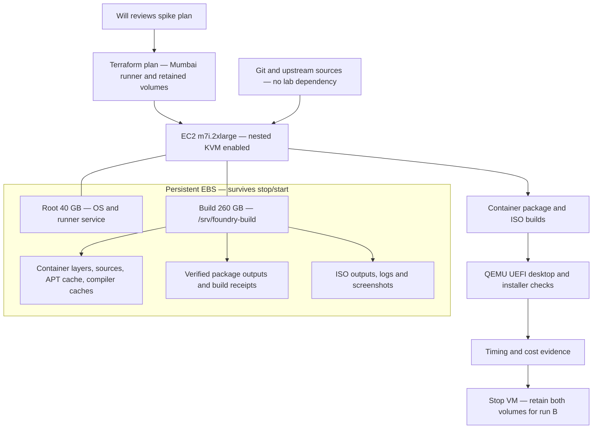
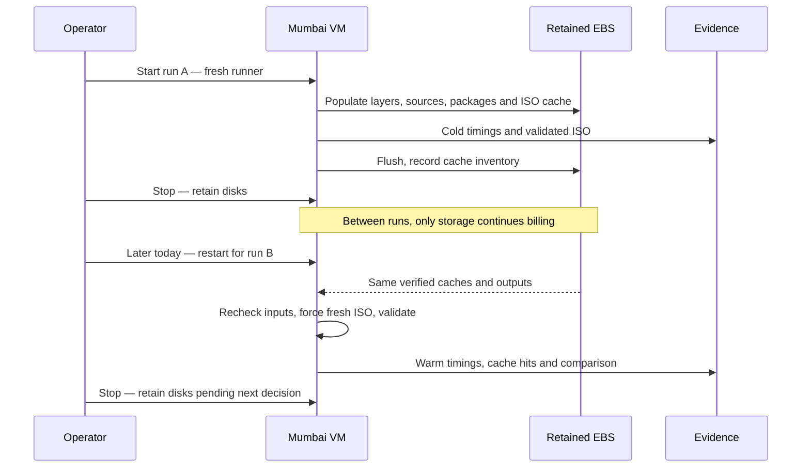

# AWS Mumbai spike: cold build, then warm build on the same disk

**Date:** 2026-11-15
**Status:** Execution plan requested by Will; no AWS runner has been launched.
**Related:** [Daily packages, ISO and public update history](2026-11-15-daily-packages-and-iso.md).

## Question and outcome

Measure how long the actual package-and-Anvil pipeline takes on AWS, then how much faster it becomes with persistent caches. **Four hours/day was a sensitivity assumption, not a forecast.** Replace it with measured cold and warm timings before choosing the daily schedule’s budget or machine size.

Will requested a fresh AWS run and a second run later today using the same retained disk. Use Mumbai (`ap-south-1`), not Singapore. The home lab is not set up and must not be a dependency. This spike produces validated candidate artifacts and timings; enabling the daily scheduler and publishing production updates remain separate steps in the parent plan.

## Experiment design

| Run | Starting state | Work performed | Evidence needed |
|---|---|---|---|
| A: cold | Newly provisioned VM and empty build/cache disk; normal OS AMI only | Bootstrap tools and pinned container stacks, fetch sources, build the current Foundry package set, build Anvil, boot and inspect installer | Separate provisioning, downloads, compilation, ISO assembly and validation timings |
| Between runs | VM stopped; **all disks and caches retained** | Flush logs/cache writes; record disk and cache inventory | EC2 stopped state, volume IDs, cache sizes and run-A receipts |
| B: warm | Restart the same VM with the same EBS volumes and committed inputs | Check inputs, reuse valid package outputs and caches, **force a new Anvil filesystem/ISO build**, repeat boot/installer checks | Cache hits/misses, bytes fetched, per-stage times, actual speedup |

For run A, use the current package set invoked by the existing full-build workflow; do not silently substitute only PowerDevil or download published Foundry binaries and call that a complete source rebuild. Classify upstream binary-repack packages honestly. Record any recipes that restore prebuilt outputs remotely. If this full bootstrap is much larger than a normal daily update, report that distinction using stage timings rather than treating its total as the daily forecast.

For run B, reuse packages only when source, recipe, patches, architecture and builder inputs match. Existing `build-all.sh` shortcuts often key on changelog version and file presence; capture a stronger input/artifact manifest for the experiment so a same-version source edit cannot create a false cache hit. Never report “ISO already exists” as a fast warm build. Also record the time for the separate no-change discovery check; it is not the full-ISO time.

Pin the Git revisions, container digests and source payload checksums for both runs. Refresh authenticated APT metadata for health, but use the same recorded package versions or a retained package snapshot for the controlled comparison. If upstream package availability prevents identical inputs, label the differences and the comparison’s limitation instead of claiming a clean benchmark. No upstream version bumps are required for this cache experiment.

## Runner and storage

Start with On-Demand Linux **m7i.2xlarge: 8 vCPUs, 32 GiB RAM**, nested virtualization enabled, and 300 GB encrypted gp3 in Mumbai. Use an Ubuntu 26.04 host image validated at provisioning, with builds in the established Ubuntu-compatible container stacks. Record AMI ID and instance/AZ identifiers. Verify `/dev/kvm` and a nested VM before doing the expensive build.

Use 40 GB root + 260 GB build/cache as an initial split. Mount the latter at `/srv/foundry-build` by filesystem UUID. Set **DeleteOnTermination=false on both volumes**, tag them with the spike/run owner, and make the stop/cleanup workflow explicitly retain them. Stop the instance between and after runs; do not terminate it, run `terraform destroy`, prune caches, or delete the volumes. Disk retention is intentional and billed until a later decision.



Use an automatically assigned IPv4 address, no inbound security-group rules, and SSM for management. Bootstrap pinned container images from an accessible verified source/export; the home-lab registry is unavailable. Keep downloaded images and build caches on the retained disk. Record the one-time bootstrap separately, but include it in the cold end-to-end total.

| Persisted data | Proposed location | Reuse rule |
|---|---|---|
| Container image/layer store | `/srv/foundry-build/docker` | Verify image digests; preserve across stop/start |
| Source archives and Git mirrors | `/srv/foundry-build/sources` | Match committed upstream pins and checksums |
| Package-manager downloads | `/srv/foundry-build/apt-cache` plus live-build’s cache directory | Retain authenticated metadata evidence; validate package hashes |
| Compiler caches, where recipes support them | `/srv/foundry-build/compiler-cache` | Key by compiler/toolchain and build inputs; do not pretend unsupported recipes use ccache |
| Package outputs and manifests | `/srv/foundry-build/packages` | Reuse only verified artifacts with matching input fingerprints |
| Live-build download cache | `/srv/foundry-build/iso/cache` | Preserve downloads while regenerating the live root and ISO |
| Logs, receipts and ISO artifacts | `/srv/foundry-build/runs/<run-id>` | Keep A and B evidence separately |

Map these stores into the existing recipes rather than assuming proposed directory names automatically enable caching. Audit source scripts for cleanup that discards downloads or useful outputs. Fresh live-build roots still need package unpack/configuration, initramfs generation and filesystem compression; caching downloads cannot remove those costs. Do not resume a partial build by invoking `lb bootstrap` over a configured root: the earlier local attempt showed that it can restore the base cache and discard the installed desktop.

## Dated agenda

### 2026-11-15 — run A, after plan review and account access

- [ ] Select the AWS account/profile and confirm the resource plan. The earlier CLI Pricing query had no credentials; public pricing was verified without account access. Check available instance capacity, Ubuntu AMI, quotas and nested virtualization support.
- [ ] Provision the dedicated runner and retained volumes through Git-managed infrastructure. Record the exact proposed billable resources; no NAT Gateway, load balancer or always-on Kubernetes control plane is needed.
- [ ] Install a runner timeout and an independent external stop guard scoped to this instance. Use an initial eight-hour maximum per run, with explicit adjustment if the measured full build needs more time; hitting the limit is an incomplete run, not a benchmark success.
- [ ] Record empty cache inventory, runner specs and input manifest. Start the cold clock before bootstrap/downloads; capture a second clock for the build-only stages.
- [ ] Build packages in containers, validate them, then build Anvil from those outputs. Measure each stage; record package skips/repack cases instead of hiding them.
- [ ] Inspect the ISO package manifest, fixed PowerDevil version and installer branding. Boot with QEMU/UEFI to a real desktop, launch Calamares without installing onto a real disk, and save screenshots/logs. QEMU process survival is insufficient.
- [ ] Flush writes, persist evidence and cache inventories, confirm retained-volume settings, then stop EC2. Preserve every cache and candidate artifact for run B.

### 2026-11-15 — run B, later today after run A completes

- [ ] Restart the same instance and verify the same volume IDs, mounts, cache manifests and builder inputs. Do not recreate or pre-clean the runner.
- [ ] Time the update check and package-cache validation. Record reused packages, actual compilation work and bytes transferred.
- [ ] Force a fresh Anvil build using cached inputs, then repeat the identical ISO and VM validation gates.
- [ ] Save the A/B comparison, cost calculation and a proposed daily budget. Stop the runner, retain both volumes and leave the scheduler disabled.

If run A or account access overruns today, mark run B pending and preserve its disk; do not claim a same-day result that did not happen. After A/B, a separately identified small package-change experiment can test incremental invalidation; it is not a substitute for either requested run.

## Run controls and review screen

The following Task entry points are proposed, not commands that already exist. Implement them through the repository’s normal container runner and infrastructure workflow before execution.

```text
AWS build spike — Mumbai
  Runner:        m7i.2xlarge / 8 vCPU / 32 GiB
  Input:         <Git SHA> / <builder digest> / <package snapshot>
  Run A:         pending — empty cache
  Run B:         pending — same disk, later today
  Retention:     KEEP root, build disk, container layers and caches
  End action:    STOP instance
  Daily timer:   DISABLED

  Review AWS resources  -> task spike:plan
  Run cold benchmark    -> task spike:run MODE=cold
  Stop and retain disk  -> task spike:stop
  Run warm benchmark    -> task spike:run MODE=warm
  Compare evidence      -> task spike:report
```



## Measurement and interpretation

| Metric | Cold A | Warm B |
|---|---|---|
| Provision/bootstrap and image pulls | To measure | To measure |
| Source/APT download bytes and time | To measure | To measure |
| Package validation, compilation and cache hits | To measure | To measure |
| Live root unpack/configuration | To measure | To measure |
| Initramfs, squashfs compression and ISO assembly | To measure | To measure |
| UEFI desktop and installer validation | To measure | To measure |
| Peak RAM, disk use and CPU utilization | To measure | To measure |
| End-to-end elapsed and billable EC2 time | To measure | To measure |
| Artifact sizes, checksums and exact package versions | To record | To record |

Report `cold_seconds / warm_seconds` for comparable stages and the whole pipeline. Do not mix provisioning with steady-state timings or infer speedup from differing package sets. Two runs establish a baseline, not a statistical reliability guarantee. Production signing, upload and live wald3n verification are not measured by this build-only spike; include an explicit remaining allowance and measure those stages before setting the production budget.

Success means both ISOs pass the same real boot/installer checks, warm cache hits are demonstrable, and the second run rebuilds its ISO. If warm time is still dominated by root setup or compression, report that and propose a focused optimization. There is no assumed “very quick” threshold to manufacture a pass.

## Spike costs and retention

Rates verified on 2026-11-15 in the [AWS pricing evidence](2026-11-15-daily-packages-and-iso-aws-rates.json): compute $0.4242/hour; public IPv4 $0.005/hour; gp3 $0.0912/GB-month. Combined running compute/IP is **$0.4292/hour**. A retained 300 GB disk allocation costs **$27.36/month**, roughly **$0.91/day** using a 30-day planning month, including while EC2 is stopped. No production artifact upload is required for these two benchmarks.

| Combined running time across A and B | Compute + IPv4 | Plus one day’s 300 GB storage |
|---|---:|---:|
| 1 hour | $0.43 | $1.34 |
| 2 hours | $0.86 | $1.77 |
| 4 hours | $1.72 | $2.63 |
| 8 hours | $3.43 | $4.34 |
| 16 hours — both initial run deadlines exhausted | $6.87 | $7.78 |

These are scenarios, not predicted runtimes; exclude tax, logs, optional snapshots and internet egress. Downloading the two approximately 5 GB ISOs out of AWS would add up to about $1.09 at $0.1093/GB if the shared egress allowance is already used. Retaining more outputs increases storage needs; monitor free space and fail before exhaustion rather than deleting caches. Budget alerts are not a hard cap; the independent stop guard bounds accidental runtime, while EBS remains chargeable by design.

After the second run, leave the instance stopped and disks intact. Present measured results and the ongoing $27.36/month storage obligation before any future decision to keep, resize, migrate or remove them. Do not delete resources automatically at the end of this spike.

## Deliverables

- [ ] Git-managed runner specification and runnable cold/warm/stop/report entry points.
- [ ] Input and artifact manifests, cache inventories, per-stage timing/resource data, and actual AWS instance/volume IDs in private runtime evidence.
- [ ] ISO desktop and installer-launch screenshots for both runs.
- [ ] A comparison report replacing the parent plan’s four-hour budgeting assumption with measured data and stated publication overhead still to measure.
- [ ] Confirmation that EC2 is stopped, both disks retained, and the daily scheduler remains disabled.

AI assistance: Codex CLI 0.169.0; model gpt-6-astra; reasoning effort medium, verified from session metadata.
