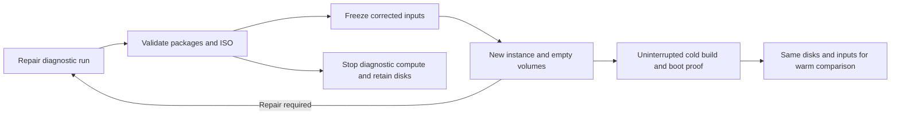
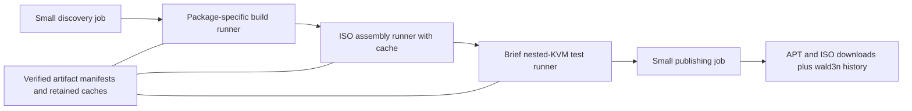
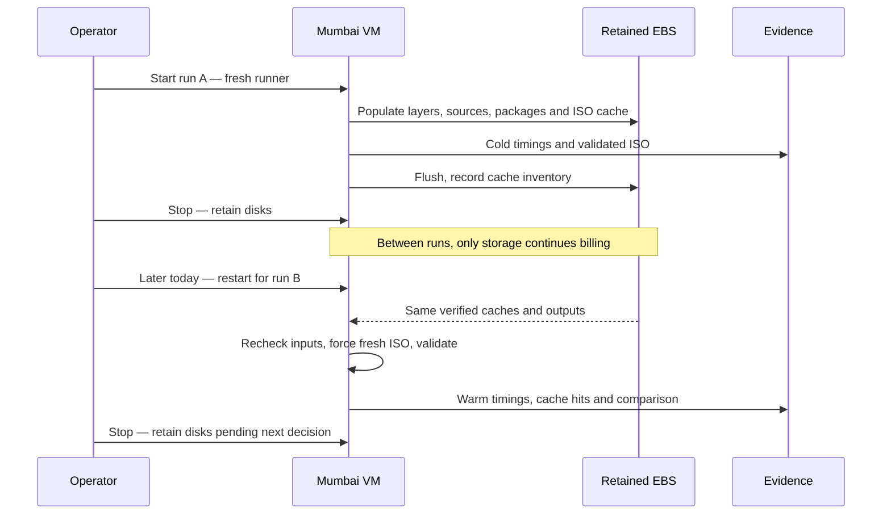

# AWS Mumbai spike: cold build, then warm build on the same disk

**Date:** 2026-11-15
**Status:** Diagnostic package/ISO build and desktop/installer launch passed; its instance is stopped with disks retained. A separate empty-volume cold run completed all 63 expected packages and ISO assembly without build intervention. Its post-build inventory collector failed because the ISO builder removes the staging chroot. This is a cold workload success, **not an error-free end-to-end runner pass**. The ISO inventory was recovered from the artifact; cold desktop boot and installer launch are visually verified; warm comparison is next.
**Related:** [Daily packages, ISO and public update history](2026-11-15-daily-packages-and-iso.md).

## Question and outcome

Measure how long the actual package-and-Anvil pipeline takes on AWS, then how much faster it becomes with persistent caches. **Four hours/day was a sensitivity assumption, not a forecast.** Replace it with measured cold and warm timings before choosing the daily schedule’s budget or machine size.

Will requested a fresh AWS run and a second run later today using the same retained disk. Use Mumbai (`ap-south-1`), not Singapore. The home lab is not set up and must not be a dependency. This spike produces validated candidate artifacts and timings; enabling the daily scheduler and publishing production updates remain separate steps in the parent plan.

## Experiment design

| Run | Starting state | Work performed | Evidence needed |
|---|---|---|---|
| Diagnostic (completed) | Fresh initial VM, subsequently repaired in place | Resolve build and runner defects, then validate the ISO | Preserve failures, interventions and all elapsed cost separately; not a clean benchmark |
| A: clean cold proof | Newly provisioned VM and empty build/cache disk; normal OS AMI only | Bootstrap tools and pinned container stacks, fetch sources, build the current Foundry package set, build Anvil, boot and inspect installer | Separate provisioning, downloads, compilation, ISO assembly and validation timings |
| Between runs | VM stopped; **all disks and caches retained** | Flush logs/cache writes; record disk and cache inventory | EC2 stopped state, volume IDs, cache sizes and run-A receipts |
| B: warm | Restart the same VM with the same EBS volumes and committed inputs | Check inputs, reuse valid package outputs and caches, **force a new Anvil filesystem/ISO build**, repeat boot/installer checks | Cache hits/misses, bytes fetched, per-stage times, actual speedup |

### Clean cold proof gate (Will’s additional requirement)

- [x] Finish the diagnostic package build, ISO assembly and real UEFI desktop/installer checks.
- [x] Freeze and publish corrected runner/recipe inputs; record commit IDs and patch hashes.
- [x] Stop the diagnostic instance and preserve both of its disks and caches.
- [x] Launch a separate instance with newly created empty root/build volumes from the recorded standard OS AMI. Do not restore diagnostic snapshots, Docker layers, Foundry packages or ISO artifacts.
- [x] Capture new instance/volume IDs, empty cache inventories, launch/bootstrap timestamps and resource counters before workloads start.
- [ ] Complete all package and ISO stages without interventions, then capture actual desktop and installer evidence and artifact hashes.
- [ ] If a repair is required, label that attempt diagnostic and repeat clean proof after fixing it.
- [ ] Run the warm comparison against this successful cold proof using its retained disks and matching inputs.



Review state: `DIAGNOSTIC → INPUTS FROZEN → EMPTY VOLUMES VERIFIED → COLD BUILD PASS → BOOT/INSTALLER PASS → WARM COMPARISON`. Each transition requires its corresponding receipt; a successful repaired build cannot advance directly to cold proof.

Keep diagnostic elapsed time and estimated charges, successful stage timings, clean cold totals and warm totals separate. GNU `time` around Docker measures useful wall time but its CPU/RSS describe the client, not the container workload. Use host and cgroup counters for resource claims. The diagnostic raw recorder started after package compilation began, so its coverage is partial; do not present observed peaks as full-run peaks. Charge calculations from rates and running intervals are estimates, not an AWS invoice. The existing diagnostic disks total 300 GiB and cost $27.36 per month at the recorded gp3 rate. Fresh-proof disk capacity will be chosen from measured peak usage, and its retention cost reported separately; do not assume a second 300-GiB allocation. Stop compute after use.

For run A, use the current package set invoked by the existing full-build workflow; do not silently substitute only PowerDevil or download published Foundry binaries and call that a complete source rebuild. Classify upstream binary-repack packages honestly. Record any recipes that restore prebuilt outputs remotely. If this full bootstrap is much larger than a normal daily update, report that distinction using stage timings rather than treating its total as the daily forecast.

For run B, reuse packages only when source, recipe, patches, architecture and builder inputs match. Existing `build-all.sh` shortcuts often key on changelog version and file presence; capture a stronger input/artifact manifest for the experiment so a same-version source edit cannot create a false cache hit. Never report “ISO already exists” as a fast warm build. Also record the time for the separate no-change discovery check; it is not the full-ISO time.

Pin the Git revisions, container digests and source payload checksums for both runs. Refresh authenticated APT metadata for health, but use the same recorded package versions or a retained package snapshot for the controlled comparison. If upstream package availability prevents identical inputs, label the differences and the comparison’s limitation instead of claiming a clean benchmark. No upstream version bumps are required for this cache experiment.

## Resource selection by stage

Will clarified that different stages should be free to use different service offerings. Do not assume the pipeline is CPU-bound or make the initial measurement runner the permanent architecture. Capture CPU utilization, peak RAM, disk IOPS/throughput/wait, network bytes, cache-hit rates, startup overhead and elapsed time separately for every stage.

| Stage | Candidate execution environment | Evidence that selects it |
|---|---|---|
| Discovery | Small scheduled container/job | Runtime, API/network demand and dependency footprint |
| Package builds | Containers on EC2 or an EC2-backed batch service, sized per package | Compile CPU, peak memory, cache hits and cost per successful package |
| ISO assembly | Container-capable EC2 runner with retained cache disk | Download, unpack/configuration, initramfs, disk I/O and compression timings |
| Desktop/installer test | Brief nested-KVM EC2 runner | Minimum comfortable host/guest RAM, real boot readiness and duration |
| Signing/publication/site update | Small isolated publishing job | Upload throughput, credentials and deployment runtime |

These are candidates, not claims that every service supports privileged live-build or nested KVM. Validate each requirement before selecting a managed offering. Discovery and publication do not need the build runner's memory or KVM. A T3 is not selected; burst credits and throttling must be included if it is benchmarked.

The first cold/warm pair may run stages sequentially on one instrumented EC2 VM to avoid confusing cache effects with hardware changes. That is an experimental control, not the daily architecture. After the matched pair, replay the expensive stages on smaller or different offerings using the same inputs. Select by total cost per validated output, including startup, transfer, persistent storage and operational complexity. Do not split stages merely to draw more boxes.



Pass immutable artifacts with checksums and input fingerprints between stages. Keep EBS caches with their owning build stage. An ordinary gp3 volume is not a shared multi-writer filesystem: detach/reattach only after clean unmount in the same AZ, or copy verified artifacts through object storage/private transfer. Count duplicate storage and transfer overhead. Keep both requested runs on the same retained disks; any hardware comparison is separately labelled.

## Runner and storage

Use a configurable On-Demand measurement runner in Mumbai. Start with **m7i.xlarge: 4 vCPUs, 16 GiB RAM** as a provisional cold/warm baseline, with nested virtualization enabled and 300 GB encrypted gp3. Record this choice in both receipts; increase memory only if measured failures require it, and restart the comparison if hardware changes between A and B. The earlier m7i.2xlarge estimates below remain a labelled reference, not a selected permanent size. Use an Ubuntu 26.04 host image validated at provisioning, with builds in the established Ubuntu-compatible container stacks. Record AMI ID and instance/AZ identifiers. Verify `/dev/kvm` and a nested VM before doing the expensive build.

The diagnostic allocation was an unmeasured capacity allowance, not a calculated cache requirement. Do not carry 300 GB into the daily design or automatically duplicate it for cold proof. Measure peak filesystem usage through the diagnostic package and ISO stages, then choose fresh-proof capacity with explicit headroom. Separate transient source/build trees and ISO work space from useful reusable downloads/toolchains. Superseded build outputs are not permanent caches; the paired experiment's unchanged-output reuse does not justify retaining obsolete outputs in production.

| Diagnostic allocation | Provisioned capacity | Observed usage at 12:55 Bangkok | Basis |
|---|---:|---:|---|
| OS/root | 40 GiB | 2.8 GiB | Initial allowance, not measured sizing |
| Build workspace and caches | 260 GiB | 7.4 GiB | Initial allowance, not a component estimate |
| Total | 300 GiB | About 10.2 GiB | Build is incomplete; these are not peak requirements |

AWS bills provisioned capacity, including unused space. Record peak used bytes separately from capacity, filesystem reserve and available bytes. Retain the current experimental disks as requested; select production cache retention and capacity from measured reusable content, rather than all generated data.

The existing diagnostic runner uses 40 GB root + 260 GB build/cache. Mount the latter at `/srv/foundry-build` by filesystem UUID. Set **DeleteOnTermination=false on both volumes**, tag them with the spike/run owner, and make the stop/cleanup workflow explicitly retain them. Stop the instance between and after runs; do not terminate it, run `terraform destroy`, prune caches, or delete the volumes. Disk retention is intentional and billed until a later decision.


Use an automatically assigned IPv4 address, no inbound security-group rules, and SSM for management. Bootstrap pinned container images from an accessible verified source/export; the home-lab registry is unavailable. Keep downloaded images and build caches on the retained disk. Record the one-time bootstrap separately, but include it in the cold end-to-end total.

| Persisted data | Proposed location | Reuse rule |
|---|---|---|
| Container image/layer store | `/srv/foundry-build/docker` | Verify image digests; preserve across stop/start |
| Source archives and Git mirrors | `/srv/foundry-build/sources` | Match committed upstream pins and checksums |
| Package-manager downloads | `/srv/foundry-build/apt-cache` plus live-build’s cache directory | Retain authenticated metadata evidence; validate package hashes |
| Compiler caches, where recipes support them | `/srv/foundry-build/compiler-cache` | Key by compiler/toolchain and build inputs; do not pretend unsupported recipes use ccache |
| Package outputs and manifests | `/srv/foundry-build/packages` | Reuse only verified artifacts with matching input fingerprints |
| Live-build download cache | `/srv/foundry-build/iso/cache` | Preserve downloads while regenerating the live root and ISO |
| Logs, receipts and ISO artifacts | `/srv/foundry-build/runs/<run-id>` | Keep A and B evidence separately |

Map these stores into the existing recipes rather than assuming proposed directory names automatically enable caching. Audit source scripts for cleanup that discards downloads or useful outputs. Fresh live-build roots still need package unpack/configuration, initramfs generation and filesystem compression; caching downloads cannot remove those costs. Do not resume a partial build by invoking `lb bootstrap` over a configured root: the earlier local attempt showed that it can restore the base cache and discard the installed desktop.

## Dated agenda

### 2026-11-15 — run A, after plan review and account access

- [ ] Select the AWS account/profile and confirm the resource plan. The earlier CLI Pricing query had no credentials; public pricing was verified without account access. Check available instance capacity, Ubuntu AMI, quotas and nested virtualization support.
- [ ] Provision the temporary runner and retained volumes using Git-managed AWS CLI scripts and a resource-ID receipt. Will explicitly accepted avoiding Terraform for this disposable experiment; no distro Terraform configuration exists. Record the exact proposed billable resources; no NAT Gateway, load balancer or always-on Kubernetes control plane is needed.
- [ ] Install a runner timeout and an independent external stop guard scoped to this instance. Use an initial eight-hour maximum per run, with explicit adjustment if the measured full build needs more time; hitting the limit is an incomplete run, not a benchmark success.
- [ ] Record empty cache inventory, runner specs and input manifest. Start the cold clock before bootstrap/downloads; capture a second clock for the build-only stages.
- [ ] Build packages in containers, validate them, then build Anvil from those outputs. Measure each stage; record package skips/repack cases instead of hiding them.
- [ ] Inspect the ISO package manifest, fixed PowerDevil version and installer branding. Boot with QEMU/UEFI to a real desktop, launch Calamares without installing onto a real disk, and save screenshots/logs. QEMU process survival is insufficient.
- [ ] Flush writes, persist evidence and cache inventories, confirm retained-volume settings, then stop EC2. Preserve every cache and candidate artifact for run B.

### 2026-11-15 — run B, later today after run A completes

- [ ] Restart the same instance and verify the same volume IDs, mounts, cache manifests and builder inputs. Do not recreate or pre-clean the runner.
- [ ] Time the update check and package-cache validation. Record reused packages, actual compilation work and bytes transferred.
- [ ] Force a fresh Anvil build using cached inputs, then repeat the identical ISO and VM validation gates.
- [ ] Save the A/B comparison, cost calculation and a proposed daily budget. Stop the runner, retain both volumes and leave the scheduler disabled.

If run A or account access overruns today, mark run B pending and preserve its disk; do not claim a same-day result that did not happen. After A/B, a separately identified small package-change experiment can test incremental invalidation; it is not a substitute for either requested run.

## Run controls and review screen

The following Task entry points are proposed, not commands that already exist. Implement them through the repository’s normal container runner and infrastructure workflow before execution.

```text
AWS build spike — Mumbai
  Runner:        configurable baseline m7i.xlarge / 4 vCPU / 16 GiB
  Stage sizing:  measure separately, choose offerings after A/B
  Input:         <Git SHA> / <builder digest> / <package snapshot>
  Run A:         pending — empty cache
  Run B:         pending — same disk, later today
  Retention:     KEEP root, build disk, container layers and caches
  End action:    STOP instance
  Daily timer:   DISABLED

  Review AWS resources  -> task spike:plan
  Run cold benchmark    -> task spike:run MODE=cold
  Stop and retain disk  -> task spike:stop
  Run warm benchmark    -> task spike:run MODE=warm
  Compare evidence      -> task spike:report
```



## Measurement and interpretation

| Metric | Cold A | Warm B |
|---|---|---|
| Provision/bootstrap and image pulls | To measure | To measure |
| Source/APT download bytes and time | To measure | To measure |
| Package validation, compilation and cache hits | To measure | To measure |
| Live root unpack/configuration | To measure | To measure |
| Initramfs, squashfs compression and ISO assembly | To measure | To measure |
| UEFI desktop and installer validation | To measure | To measure |
| Peak RAM, disk use and CPU utilization | To measure | To measure |
| End-to-end elapsed and billable EC2 time | To measure | To measure |
| Artifact sizes, checksums and exact package versions | To record | To record |

Report `cold_seconds / warm_seconds` for comparable stages and the whole pipeline. Do not mix provisioning with steady-state timings or infer speedup from differing package sets. Two runs establish a baseline, not a statistical reliability guarantee. Production signing, upload and live wald3n verification are not measured by this build-only spike; include an explicit remaining allowance and measure those stages before setting the production budget.

Success means both ISOs pass the same real boot/installer checks, warm cache hits are demonstrable, and the second run rebuilds its ISO. If warm time is still dominated by root setup or compression, report that and propose a focused optimization. There is no assumed “very quick” threshold to manufacture a pass.

## Spike costs and retention

**Reference scenario for the earlier 8-vCPU runner, not the selected baseline:** rates verified on 2026-11-15 in the [AWS pricing evidence](2026-11-15-daily-packages-and-iso-aws-rates.json): compute $0.4242/hour; public IPv4 $0.005/hour; gp3 $0.0912/GB-month. Combined running compute/IP is **$0.4292/hour**. A retained 300 GB disk allocation costs **$27.36/month**, roughly **$0.91/day** using a 30-day planning month, including while EC2 is stopped. No production artifact upload is required for these two benchmarks.

| Combined running time across A and B | Compute + IPv4 | Plus one day’s 300 GB storage |
|---|---:|---:|
| 1 hour | $0.43 | $1.34 |
| 2 hours | $0.86 | $1.77 |
| 4 hours | $1.72 | $2.63 |
| 8 hours | $3.43 | $4.34 |
| 16 hours — both initial run deadlines exhausted | $6.87 | $7.78 |

These are scenarios, not predicted runtimes; exclude tax, logs, optional snapshots and internet egress. Downloading the two approximately 5 GB ISOs out of AWS would add up to about $1.09 at $0.1093/GB if the shared egress allowance is already used. Retaining more outputs increases storage needs; monitor free space and fail before exhaustion rather than deleting caches. Budget alerts are not a hard cap; the independent stop guard bounds accidental runtime, while EBS remains chargeable by design.

After the second run, leave the instance stopped and disks intact. Present measured results and the ongoing $27.36/month storage obligation before any future decision to keep, resize, migrate or remove them. Do not delete resources automatically at the end of this spike.

The provisional m7i.xlarge baseline is $0.2121/hour compute in the Mumbai price query, or $0.2171/hour including one public IPv4. Confirm the current rate before launch. For example, two combined running hours would be about $0.43 compute/IP plus about $0.91 for one day of retained 300 GB storage. Stage-specific production cost will be the sum of each stage's measured billable time and rate, plus shared storage and artifact transfer; it cannot be inferred from one hourly rate.

## Deliverables

- [ ] Git-managed AWS CLI runner scripts, exact resource-ID receipts and runnable cold/warm/stop/report entry points; Terraform is unnecessary for this temporary spike.
- [ ] Stage-by-stage resource profiles and a comparison of candidate service offerings, including artifact handoff costs.
- [ ] Input and artifact manifests, cache inventories, per-stage timing/resource data, and actual AWS instance/volume IDs in private runtime evidence.
- [ ] ISO desktop and installer-launch screenshots for both runs.
- [ ] A comparison report replacing the parent plan’s four-hour budgeting assumption with measured data and stated publication overhead still to measure.
- [ ] Confirmation that EC2 is stopped, both disks retained, and the daily scheduler remains disabled.

AI assistance: Codex CLI 0.169.0; model gpt-6-astra; reasoning effort medium, verified from session metadata.

## Execution preparation — 2026-11-15

- [x] AWS wf-terraform identity verified; Mumbai M7i nested virtualization and Canonical Ubuntu 26.04 AMI checked.
- [x] Added [launch controller](../../scripts/aws-spike/launch.py), [host bootstrap](../../scripts/aws-spike/bootstrap.sh), and [measurement runner](../../scripts/aws-spike/run.sh). Launch payload fits EC2 user-data; Python syntax checked in the pinned test container and shell scripts pass bash syntax checks.
- [x] Launch and record instance/volume IDs in the private receipt `/home/will/powerdevil-upgrade/aws-spike/resources.json`.
- [ ] Finish diagnostic package/ISO stages, then run the separate measured UEFI desktop/installer validation.

The launcher creates only a dedicated security group, SSM instance role/profile, runner with retained volumes, and a scoped deadline role/schedule in the existing default VPC. It records every created resource and stops a launched instance if later provisioning fails. No signing or production publication credentials are sent to the runner. The automatic build service stops the instance after build success or failure; test and warm-run starts are explicit.

## Live diagnostic run — 2026-11-15

Runner `i-09ed2b15f19ac5b71`, m7i.xlarge, ap-south-1a, launched at 11:58 Bangkok. Root volume `vol-0926caa68cf02bb0f` and build/cache volume `vol-00d37a922a21b2381` both have DeleteOnTermination=false. Nested virtualization is enabled; cloud-init completed and the cold-run service is active. Independent stop deadline: 19:58 Bangkok. Build inputs: Foundry `96906db229416a053959db58d43f54471336b0dc`, home-lab stacks `a0d9ec5279b5f63662889f3db1153284aed752ea`. No production publication is part of this spike.

### Diagnostic setup correction and early observations

Docker uses the containerd snapshotter on this Ubuntu image. Docker's data-root setting alone left its image/layer store under `/var/lib/containerd` on the 40 GB root volume. The cold run was stopped, all existing containerd data moved to the retained build volume and bind-mounted back, and the retained package container resumed. No cache was pruned. The bootstrap script now handles this store before starting a new run. Original logs survive in `runs/cold-before-storage-fix` and `runs/cold-before-resume-fix`; setup correction time must remain separate from package/ISO timings.

Observed initial stages: host bootstrap 38 seconds, base stack 38 seconds, build stack 71 seconds, packaging stack 54 seconds, project package-builder layer 191 seconds. On the interrupted-run restart, these image builds reused their layers in approximately one second total. This confirms image-layer reuse only; it is not the warm A/B result. Source packages including drmon and f9dasm passed; the full package set and ISO remain in progress. Early preparation samples were mostly idle and used little memory, so resource sizing remains unproven.

### Recipe repairs under validation

The diagnostic package pass failed Flycast because tinygettext’s nested tinycmmc checkout was absent. The spike includes Will’s existing nested-submodule correction as an explicit hashed patch without staging unrelated working-tree changes. RPCS3’s generated build-dependency helper was removed by APT instead of switching the conflicting curl development package. A direct `apt-get -s build-dep` simulation resolves the dependencies by replacing the GnuTLS development variant with OpenSSL; the spike patch uses direct source build-dependency resolution. Both actual builds still need to pass before corrected inputs are frozen.

New-run instrumentation records raw host and container cgroup counters from bootstrap and build startup, preserves attempt logs, and refuses an existing package container as clean cold input. Warm package reuse requires an exact recipe/builder fingerprint and hashes of every retained output; it remains separate from a forced ISO rebuild.

### Local package preference

Will requested making local-candidate preference permanent. ISO staging now retains the newest available local build of each package even when the public repository has the same version. The install hook explicitly reinstalls selected local files and retains the edition dependency filter, so Atelier-only candidates do not enter Anvil. This removes the preliminary published-version fetch/filter; it does not claim that every earlier live-build dependency download is eliminated. Diagnostic execution initially used an equivalent patch; the clean proof will use the committed permanent change.

### Diagnostic checkpoint — 13:20 Bangkok

Flycast passed after its nested-submodule repair. RPCS3 passed dependency installation and source preparation and is compiling. The independent binary-inventory audit found 62 of 63 expected binaries with matching Debian package name, version and architecture; only the in-progress RPCS3 binary is missing. ISO assembly, VM validation, clean cold proof and warm comparison are still pending. The permanent local-package preference passed an isolated Ubuntu container test: same-version files were replaced from the local archive with zero archive download, and an Atelier candidate was excluded from Anvil.

### Diagnostic supervision interruption — 13:19 Bangkok

The host’s unattended upgrader updated libc and restarted transient services. It stopped the diagnostic controller, whose restart then rejected its existing run directory. The package container itself continued compiling RPCS3; Docker reported it running and not OOM-killed. The controller’s `exit-code` file contained zero from its termination trap and must not be interpreted as successful package completion. Host APT history and journal entries identify the interruption.

Supervision continues in `runs/diagnostic-continuation`, with Docker log timestamps covering the detach interval and an explicit `docker wait` plus container-exit check. Periodic APT timers are disabled for this temporary benchmark; the corrected bootstrap does this before workloads start and lists rather than automatically restarts services during bootstrap package installation. Interrupt signals now produce nonzero runner exits. Fresh cold attempts also reject an existing source tree, image, container or populated download cache. Host kernel and installed-package inventories are retained for comparison. This remains diagnostic evidence, not clean cold timing.

### Diagnostic package completion — 13:52 Bangkok

- [x] All 63 expected binary packages exist with the required package names, versions and architectures; the independent inventory audit reports no missing binaries.
- [x] Flycast and RPCS3 completed after their recorded recipe repairs.
- [x] A diskless nested-KVM guest ran until the deliberate three-second timeout; this is infrastructure preflight, not ISO validation.
- [ ] ISO assembly is in progress, starting with base-system download, validation and configuration.
- [ ] Actual ISO desktop/installer validation, clean cold proof and warm comparison remain pending.

After package-build scratch cleanup, the build filesystem used about 9.4 GiB, down from an observed 17 GiB near package completion. These observations do not yet include the ISO-stage peak. The completed inventory is retained at `runs/diagnostic-continuation/package-inventory.json` on the runner and copied with SHA256 verification to `/home/will/powerdevil-upgrade/aws-spike/evidence/package-inventory-63-of-63.json`.

### Same-version preference and frozen-input downgrades

The diagnostic ISO hook reinstalled 25 same-version packages but also selected six older frozen local builds: foundry-core, halfempty, powerdevil, tilemap-studio and xemu/xemu-xbox. The permanent default now skips local versions older than the installed repository version and does not permit implicit APT downgrades. Same-version local replacement remains enabled. An explicit spike patch sets `FOUNDRY_ALLOW_OLDER_LOCAL=1` so the controlled cold/warm comparison tests its frozen source inputs even when publication has advanced. This is candidate validation, not production publication. An isolated Ubuntu container test passed same-version replacement, default rejection of older local builds, and the explicit controlled override.

### Diagnostic validation complete; fresh proof sizing

The diagnostic ISO finished at 14:16:39 Bangkok with exit code 0. ISO assembly took **25 minutes 32.75 seconds**; this is wall time, not Docker-client CPU/RSS. The 4.5-GiB candidate SHA256 is `1b4222ffd96a97ac8d6da6e5d9c3489a1c40c1637b59c779c6436181e4cc7e76`. The instance then stopped automatically and was restarted for VM validation.

A 2-vCPU, 4096-MiB offline UEFI/KVM guest displayed the Foundry desktop and welcome window. Its desktop screenshot was captured at 14:28:14 Bangkok. The actual `/usr/local/bin/launch-calamares.sh` entry point opened the branded Calamares installer. The deliberately diskless guest reports no installation target; **full installation to disk was not tested**. Local screenshots and the result receipt are under `/home/will/powerdevil-upgrade/aws-spike/evidence/`.

The 4,923 filesystem samples from 12:56:36 to 14:18:39 Bangkok cover the complete ISO stage and the later diagnostic package work. Peak used space was **34,426,802,176 bytes (32.1 GiB)** on the build disk and **3,884,081,152 bytes (3.6 GiB)** on root. Earlier uninstrumented package phases are not reconstructed. Fresh proof will use **16 GiB root + 48 GiB build/cache = 64 GiB**, giving build-space headroom above the measured peak. At the recorded gp3 rate, that new allocation is $5.84/month (about $0.19/day), separate from the preserved diagnostic disks’ $27.36/month. This is experimental capacity, not a permanent cache-retention recommendation.

- [x] Diagnostic package inventory, ISO build, desktop boot and installer launch validated.
- [ ] Stop diagnostic compute while retaining its disks and evidence.
- [ ] Launch a separate empty 64-GiB runner with frozen corrected inputs; complete uninterrupted cold proof.
- [ ] Run the matched warm comparison on the proof runner’s retained disks.

### Fresh-launch rejection before instance creation

The first fresh-launch request was rejected because user data exceeded 16,384 bytes. No EC2 instance or EBS volumes were created. Inspection of the diagnostic instance’s stored user data confirmed an extra base64 layer: the CLI already encodes `run-instances` user data. The launcher now passes the raw compressed file using `--user-data fileb://...`, records its SHA256, and retains the exact payload beside the resource receipt. See [AWS user-data documentation](https://docs.aws.amazon.com/AWSEC2/latest/UserGuide/user-data.html). The failed launch receipt is preserved; its unused instance role/profile and security group are cleaned up before retry. This is a provisioning failure, not a completed cold-build attempt.

### Clean cold proof launched — 15:18 Bangkok

Instance `i-0dbf1f3dfdb62cc29` launched at 15:18:53 Bangkok in ap-south-1a with frozen source `4664e52e1cb104f30be09e4df294cc0269b0e1b0`. New retained volumes are root `vol-0ba1c9a2cc663aab7` (16 GiB) and build/cache `vol-0a8ddc6eb2371c5a4` (48 GiB); neither is a diagnostic volume. The diagnostic instance is stopped. The private proof receipt is `/home/will/powerdevil-upgrade/aws-spike/cold-proof-v2-resources.json`, including exact payload hashes. Independent stop deadline: 23:18:59 Bangkok.

Bootstrap completed without intervention. The cold runner verified absent source checkout, Docker images/containers and populated download cache at 15:19:38. Its initial image inventory contains only the column header. Source clone passed at 15:19:41, the base stack passed at 15:20:15, and the next stack layer is building. These establish the empty starting state; **clean cold completion is still pending**.


### Cold workloads complete; evidence collector error — 17:16 Bangkok

The fresh runner completed packages at 16:51:13 and its independent audit at 16:51:14: **63 expected binaries, none missing**. Package-stage wall time was **1 h 24 min 55 s** (15:26:18–16:51:13). ISO assembly ran 16:51:27–17:16:00: **24 min 33 s**. Neither workload required intervention. The final ISO SHA256 is `b3132d28d6d0f3c651a980801c1fd1d4467605816ff62f87cec095ccde3a68a2`.

After ISO success, `run.sh` attempted to copy `chroot/var/lib/dpkg/status`, but the normal ISO script had already deleted that temporary directory. The runner correctly recorded **exit 1**, finished at 17:16:00, and scheduled shutdown at 17:18. Preserve this failure: an uninterrupted cold package/ISO build is proven, but an error-free full runner is not. The instance was restarted for separately measured validation. Its original runner is preserved as `/opt/foundry-spike/run.sh.cold-pinned`; any subsequent collector change has a separate hash receipt.

The inventory is recoverable directly from the shipped SquashFS. Extraction confirmed **no installed `libreoffice*` packages**: Kubuntu temporarily installs them, and Foundry's existing cleanup removes them before image compression. Avoiding their initial download/install is a possible later optimization, deliberately excluded from this matched measurement. The deleted chroot is scratch space; retained Docker layers, download caches, built packages and the cache-verification receipt are unaffected.

The cold ISO is hard-linked into its run directory before a warm rebuild can replace the distribution output. A diskless, offline 2-vCPU/4096-MiB UEFI guest displayed the Foundry desktop, captured at 17:28:06. Screenshot evidence is `/home/will/powerdevil-upgrade/aws-spike/evidence/cold-boot-1.png`, SHA256 `2218f0171aa697a5ec943354cc2caf72c728586b292d0baa1f78ece4f893cf47`. Installer launch is also visually verified; the diskless guest correctly reports no target partitions, so full disk installation remains untested. The warm comparison will explicitly distinguish unchanged workload/cache inputs from the corrected post-build evidence collector. A fully unattended end-to-end cold-run claim still requires a fresh successful run of the corrected runner.


### Cold validation and collector correction

The installer screenshot is retained at `/home/will/powerdevil-upgrade/aws-spike/evidence/cold-installer.png`, SHA256 `6f1254fe453ae9d1b8823426f231e3cbe2255d007c84cc55b669c526c54557da`. The collector now reads the package database from the finished ISO through a temporary read-only loop mount, after preserving the artifact and hash. Its output matched the independently recovered cold inventory byte-for-byte. This correction changes post-build evidence collection only; warm source, recipe, builder and package-artifact fingerprints must still match the cold receipt.

The cold observer recorded 6,982 samples from 15:19:38.252 to 17:15:59.950 Bangkok. Maximum sampled filesystem usage was **34,310,283,264 bytes (32.0 GiB)** on the build volume and **2,984,787,968 bytes (2.8 GiB)** on root. Package-container cgroup memory peak was 12,301,942,784 bytes, including file cache; its sampled anonymous-memory maximum was 3,393,347,584 bytes. These different counters must not be conflated into a RAM requirement. Hardware downsizing still needs an actual trial; no final stage-specific instance selection is proven yet.
