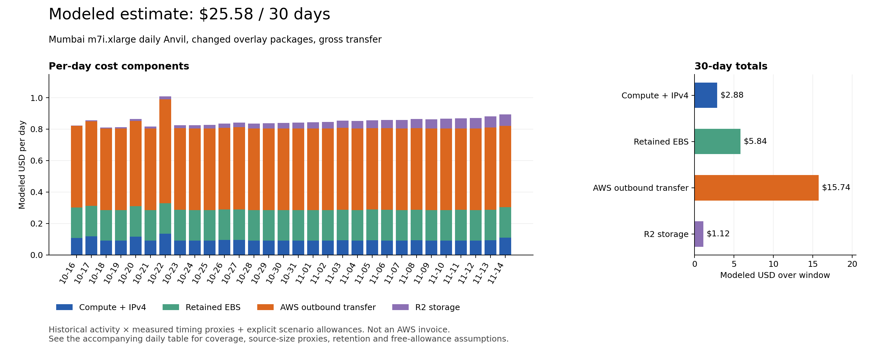

# Daily Foundry build costs from 30 days of activity

**Evidence window:** 16 October–14 November 2026, inclusive, Asia/Bangkok. **Status:** collected upstream and local activity; offline baseline and future-repeat simulations generated. This is an estimate of operating a daily publisher, not charges incurred during those historical days. Optimization implementation and the next AWS benchmark are deferred until tomorrow.

**Main estimate: $0.85/day, or $25.58 for 30 daily runs**, using the measured m7i.xlarge build process, one fresh Anvil ISO each day, changed overlay packages, retained 64-GiB EBS, gross AWS egress, and 30-day retention of new daily artifacts starting empty. Existing published repository storage is outside this incremental estimate unless supplied as `existing_r2_gb`. A repeating workload with retention already full reaches **$26.62 per 30 days ($0.89/day)**. These are scenario totals for the included components; taxes, failures and ancillary services remain outside them.

[Graph SVG](assets/daily-cost-2026-11-15/daily-costs.svg) · [Daily CSV](assets/daily-cost-2026-11-15/baseline/daily.csv) · [Simulation JSON](assets/daily-cost-2026-11-15/baseline/simulation.json) · [Reusable tool and instructions](../../scripts/aws-spike/DAILY-COST-HISTORY.md).

## What was measured and what is modeled

The collector covers the **58 current Foundry overlay recipes**, excluding packages marked for the separate Shared Electron repository. It does not claim to query release histories for all 2,812 packages in the ISO. Ubuntu archive updates are handled by the daily ISO refresh and are not counted as source builds by Foundry. The current recipe catalog is projected backward; historical catalog membership and deleted upstream releases are not reconstructed.

There are **36 raw dated events**: 29 upstream events and seven recipe-change events from three local commits. After the baseline's PowerDevil 6.6 maintenance-branch filter and per-package/per-day coalescing, upstream activity calls for **22 recipe rebuilds on 14 days**; repository activity calls for **six recipe rebuilds on one day**. Their union is **28 rebuilds on 15 days**. Multiple same-day uv releases, for example, become one build. These are eligible rebuild opportunities under the stated policy, not proof that Foundry historically published each release.

Stable GitHub release publication dates and PyPI upload dates are primary evidence. Five PowerDevil tags lack GitHub release records and have tag/commit-date proxies; the four 6.7/6.8 branch tags are retained in the JSON but excluded from the baseline. The 6.6.7 tag-date proxy remains. Four libvgm commits coalesce into three snapshot-build days. Snapshot streams for xemu and drmon have no events in this window. All API queries completed; “no events” describes the current feed/policy, not proof that no upstream work happened elsewhere.

The 58 build intervals come from timestamped cold-run Docker logs and total 5,089 seconds, versus the 5,095-second full package stage. Each interval includes source preparation, dependency work, compile/test and packaging until the next recipe begins. Changed-version builds use these intervals as **timing proxies**; we did not rebuild every historical version. Binary sizes are measured AWS artifacts. Source sizes are separately verified local DSC inventories matching current recipe versions; all 58 passed size/SHA256 checks. They proxy historical/future payload sizes. Upstream changes upload new source archives; repo-only revisions reuse existing orig archives.

The model assumes correct per-recipe selective reuse. The experiment proved whole-set unchanged-output reuse; per-recipe fingerprints now have container fixture and a real package cache-hit check, while full changed-source and promotion validation remain pending. No hypothetical compiler-cache or other optimization savings are included.

## Daily operating assumptions

| Input | Baseline | Evidence or status |
|---|---:|---|
| Instance | m7i.xlarge, Mumbai, 4 vCPU / 16 GiB | Actual spike hardware |
| Compute + public IPv4 | $0.2171/hour | $0.2121 + $0.005; auto-assigned address only while running |
| Warm ISO workflow | 1,089 s/day | Measured, including cache verification/orchestration |
| Changed package work | Sum of selected recipe intervals | Measured cold intervals used as future estimates |
| Discovery | 60 s/day | Editable allowance, unmeasured automated job |
| Instance start | 60 s/day | Editable allowance |
| Desktop + installer-launch validation | 180 s/day | Editable automated allowance; manual spike timings are not substituted |
| Publication | 120 s/day | Editable allowance, not measured upload performance |
| EBS | 64 GiB × $0.0912/GiB-month | Capacity retained all month; 16 root + 48 build |
| Outbound AWS transfer | $0.1093 per modeled GB | Gross; no account-wide free allowance assumed |
| R2 storage | $0.015/GB-month | 30-day rolling history, initially empty |
| Units | Decimal GB for modeled transfer/R2; GiB for EBS | Explicit conservative planning conversion; `egress_bytes_per_gb` is adjustable |

The seven minutes of daily allowances add about **$0.76/month** in compute/IP. They are not measured savings or guaranteed runtimes. Every extra minute per daily run changes 30-day compute/IP cost by about **$0.109**. Changing the hourly rate does not automatically scale measured timings. R2 storage is accrued at daily granularity; billing rounding, request charges and metadata-index uploads are excluded. No NAT gateway is assumed.

The daily publisher would transfer approximately **144.02 modeled GB over 30 days**, overwhelmingly ISO payloads. Transfer is therefore the largest modeled cost, not package compilation.

## Cost breakdown

| Component | Average/day | 30-day total |
|---|---:|---:|
| Compute + IPv4, including explicit allowances | $0.096 | $2.88 |
| Retained 64-GiB EBS | $0.195 | $5.84 |
| AWS outbound transfer, no free allowance | $0.525 | $15.74 |
| R2 storage, first-month accumulation | $0.037 | $1.12 |
| **Included-component total** | **$0.853** | **$25.58** |

If all **100 GB/month of AWS's account-wide internet egress allowance** were available to Foundry, replaying this workload into a single billing month gives **$14.65/30 days**. That is a separate conditional scenario, not the baseline. The historical window crosses October and November; the alternative deliberately starts on 1 December so it does not improperly claim two months of free allowance for a “monthly” quote. Existing account usage has not been checked. R2 account free allowances are also not assumed. See [AWS transfer policy](https://aws.amazon.com/ec2/pricing/on-demand/) and [R2 pricing](https://developers.cloudflare.com/r2/pricing/).

The separate retained diagnostic **300-GiB disks add $27.36/month** while kept. They are not needed for this modeled daily runner and are excluded from its total. They have not been deleted. Existing published-repository storage, initial cold bootstrap, repeated failed builds, full disk-install testing, signing/monitoring services, request charges, website publishing and taxes are outside this incremental model. Repo-only revisions presume their original source archive already exists in the publication repository. Both spike instances were left stopped after the read-only timing extraction; no new build was run for this analysis.

## If the 4-GiB build trial succeeds

A Mumbai **c7i.large (2 vCPU, 4 GiB)** is $0.08925/hour plus $0.005/hour public IPv4, versus $0.2171/hour combined for the measured m7i.xlarge. Apply this cheaper rate only to package/ISO build stages. The 4-GiB validation guest still needs a larger host; discovery/startup/validation/publication allowances retain the baseline rate in these scenarios. This is a sensitivity calculation pending tomorrow's trial, not a claim that 4 GiB is enough.

| Build runtime on c7i.large | Build-stage compute/IP | Total per 30 days | Saving per 30 days |
|---|---:|---:|---:|
| Same time (unproven) | $0.919 | $24.38 | $1.20 |
| 50% longer | $1.379 | $24.84 | $0.74 |
| Twice as long | $1.839 | $25.30 | $0.28 |

At equal runtime, this saves **about $1.20/month**, or $0.040/day, for the observed activity. Build time could grow to about **2.30×** before build-stage compute savings disappear. The small total saving is because outbound ISO uploads and retained disks dominate this scenario; changing RAM does not reduce those charges. Additional host transitions, artifact transfers and failure/retry time are not measured and could consume the saving.

The [c7i.large rate receipt](assets/daily-cost-2026-11-15/aws-c7i-large-rate.json) and [same-time](assets/daily-cost-2026-11-15/4gb-same-time-scenario.json), [1.5×](assets/daily-cost-2026-11-15/4gb-50pct-slower-scenario.json), and [2×](assets/daily-cost-2026-11-15/4gb-double-time-scenario.json) scenarios are saved. `build_compute_per_hour`, `build_ipv4_per_hour` and `build_runtime_multiplier` make the assumption explicit; changing hardware never silently grants a speedup.

## Per-day table

Each row estimates one fresh ISO publication plus the selected recipe changes. Costs include the allowances above. An em dash means no selected event on that date. PowerDevil's 16 October upstream entry uses an explicitly approximate tag date; libvgm entries are snapshot commit days.

| Bangkok date | Upstream recipe updates | Repo recipe changes | Build proxy min | Compute/IP | EBS | Egress | R2 | Total USD |
|---|---|---|---:|---:|---:|---:|---:|---:|
| 2026-10-16 | powerdevil, python3-glfw | — | 4.62 | 0.108 | 0.195 | 0.518 | 0.002 | **0.823** |
| 2026-10-17 | libvgm, xemu-xbox | — | 7.37 | 0.118 | 0.195 | 0.539 | 0.005 | **0.856** |
| 2026-10-18 | — | — | 0.00 | 0.091 | 0.195 | 0.518 | 0.007 | **0.810** |
| 2026-10-19 | — | — | 0.00 | 0.091 | 0.195 | 0.518 | 0.010 | **0.813** |
| 2026-10-20 | uv, xemu-xbox | — | 6.99 | 0.116 | 0.195 | 0.542 | 0.012 | **0.865** |
| 2026-10-21 | — | — | 0.00 | 0.091 | 0.195 | 0.518 | 0.014 | **0.818** |
| 2026-10-22 | ghidra, uv, xemu-xbox | — | 12.12 | 0.135 | 0.195 | 0.661 | 0.017 | **1.008** |
| 2026-10-23 | ruff | — | 0.20 | 0.092 | 0.195 | 0.520 | 0.020 | **0.826** |
| 2026-10-24 | — | — | 0.00 | 0.091 | 0.195 | 0.518 | 0.022 | **0.825** |
| 2026-10-25 | — | — | 0.00 | 0.091 | 0.195 | 0.518 | 0.025 | **0.828** |
| 2026-10-26 | vgmstream | — | 1.04 | 0.095 | 0.195 | 0.519 | 0.027 | **0.835** |
| 2026-10-27 | libvgm, ruff, uv | — | 1.17 | 0.095 | 0.195 | 0.524 | 0.029 | **0.843** |
| 2026-10-28 | — | — | 0.00 | 0.091 | 0.195 | 0.518 | 0.032 | **0.835** |
| 2026-10-29 | — | — | 0.00 | 0.091 | 0.195 | 0.518 | 0.034 | **0.837** |
| 2026-10-30 | — | — | 0.00 | 0.091 | 0.195 | 0.518 | 0.036 | **0.840** |
| 2026-10-31 | — | — | 0.00 | 0.091 | 0.195 | 0.518 | 0.039 | **0.842** |
| 2026-11-01 | — | — | 0.00 | 0.091 | 0.195 | 0.518 | 0.041 | **0.844** |
| 2026-11-02 | — | — | 0.00 | 0.091 | 0.195 | 0.518 | 0.044 | **0.847** |
| 2026-11-03 | uv | — | 0.30 | 0.092 | 0.195 | 0.521 | 0.046 | **0.854** |
| 2026-11-04 | — | — | 0.00 | 0.091 | 0.195 | 0.518 | 0.048 | **0.851** |
| 2026-11-05 | libvgm | — | 0.68 | 0.093 | 0.195 | 0.518 | 0.051 | **0.857** |
| 2026-11-06 | ruff | — | 0.20 | 0.092 | 0.195 | 0.520 | 0.053 | **0.859** |
| 2026-11-07 | — | — | 0.00 | 0.091 | 0.195 | 0.518 | 0.055 | **0.859** |
| 2026-11-08 | pvsneslib | — | 0.53 | 0.093 | 0.195 | 0.519 | 0.058 | **0.865** |
| 2026-11-09 | — | — | 0.00 | 0.091 | 0.195 | 0.518 | 0.060 | **0.863** |
| 2026-11-10 | — | — | 0.00 | 0.091 | 0.195 | 0.518 | 0.063 | **0.866** |
| 2026-11-11 | python3-picire | — | 0.10 | 0.091 | 0.195 | 0.518 | 0.065 | **0.868** |
| 2026-11-12 | python3-librosa | — | 0.08 | 0.091 | 0.195 | 0.518 | 0.067 | **0.871** |
| 2026-11-13 | ruff, uv | — | 0.49 | 0.093 | 0.195 | 0.523 | 0.070 | **0.880** |
| 2026-11-14 | — | foundry-desktop, powerdevil, python3-inators, python3-mss, python3-picire, python3-pydub | 4.89 | 0.109 | 0.195 | 0.518 | 0.072 | **0.893** |

## Comparing activity policies

All variants below still build/publish an ISO every day. Their small cost differences reflect that package changes are a small share of this workload.

| Activity policy | Recipe rebuilds | Active recipe days | 30-day cost |
|---|---:|---:|---:|
| Upstream + repo (baseline) | 28 | 15 | $25.58 |
| Upstream releases/tag proxies/snapshots | 22 | 14 | $25.56 |
| Only local recipe commits | 6 | 1 | $25.22 |
| Only dated stable release publications; no tag proxies/snapshots | 18 | 13 | $25.54 |

## Reproduce and project

- [Collector/simulator](../../scripts/aws-spike/daily-cost-history.py): `collect`, `import-sizes`, and offline `simulate` subcommands. It never starts EC2 or publishes anything.
- [CLI instructions](../../scripts/aws-spike/DAILY-COST-HISTORY.md) and [baseline scenario](../../scripts/aws-spike/daily-cost-baseline.json).
- [Normalized dated events and coverage](assets/daily-cost-2026-11-15/activity.json), [raw cached API receipts](assets/daily-cost-2026-11-15/api-cache/), and [recipe-source inventory](assets/daily-cost-2026-11-15/recipes.json).
- [Raw AWS timing/size receipt](assets/daily-cost-2026-11-15/build-measurements-raw.json), SHA256 `06450d482dc94358625ec2723bab2b66a7b2d49151cb5db9d655cce80cf53d79`; [enriched source-size measurements](assets/daily-cost-2026-11-15/build-measurements.json).
- [90-day repeated-history projection](assets/daily-cost-2026-11-15/repeat-90-days/simulation.json). Repeats this sequence; it does not forecast future releases. Later 30-day blocks show full rolling retention.
- [Conditional free-egress scenario](assets/daily-cost-2026-11-15/available-free-egress-scenario.json), with its [result](assets/daily-cost-2026-11-15/available-free-egress/simulation.json).

For future projections, reuse `activity.json` and edit a copy of the scenario: instance price, explicit timing overrides, selected upstream branches, snapshot policy, daily versus changed-only ISO policy, retention, or available free allowance. `--projection-days` repeats the observed sequence for the requested duration; `projection_start` controls the calendar. No upstream re-fetch is needed to rerun a cost scenario. New activity collection uses a 24-hour API-cache freshness limit by default and supports `--refresh`.

## Source provenance

Release/commit URLs are attached to every normalized event, and each feed has the exact cached request/response and retrieval timestamp. Examples: [uv releases](https://github.com/astral-sh/uv/releases), [ruff releases](https://github.com/astral-sh/ruff/releases), [xemu-xbox releases](https://github.com/xemu-project/xemu/releases), [Ghidra releases](https://github.com/NationalSecurityAgency/ghidra/releases), [libvgm commits](https://github.com/ValleyBell/libvgm/commits/master/), and [PowerDevil tags](https://github.com/KDE/powerdevil/tags). These are upstream observations, not Foundry publication logs.

Pricing inputs are separated from activity: [saved Mumbai EC2/gp3/transfer rates](2026-11-15-daily-packages-and-iso-aws-rates.json), [fresh m7i.xlarge Pricing API response](assets/daily-cost-2026-11-15/aws-m7i-rate.json), [AWS IPv4 pricing](https://aws.amazon.com/vpc/pricing/), [AWS egress policy](https://aws.amazon.com/ec2/pricing/on-demand/), and [R2 pricing](https://developers.cloudflare.com/r2/pricing/). This is a reproducible planning calculation, not an AWS/Cloudflare invoice or a guarantee that all upstream changes can be promoted without repair.

