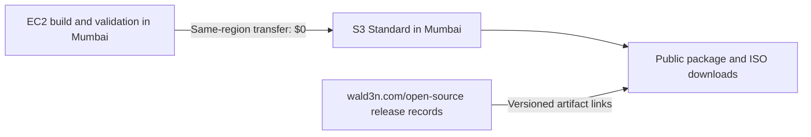

# Daily Foundry build costs from 30 days of activity

**Evidence window:** 16 October–14 November 2026, Asia/Bangkok. **Corrected publication architecture:** EC2 builds and S3 Standard artifact storage are both in Mumbai (`ap-south-1`). Publication no longer copies AWS-built artifacts to R2.

**Build and publication estimate: $10.46 for the first 30 days ($0.35/day), or $12.07 per 30 days with retention full.** These totals exclude public download traffic and request charges. The earlier $25.58 estimate incorrectly assumed uploading every daily build out of AWS to R2; it is superseded.

[Daily CSV](assets/daily-cost-2026-11-15/baseline/daily.csv) · [Simulation JSON](assets/daily-cost-2026-11-15/baseline/simulation.json) · [Reusable script instructions](../../scripts/aws-spike/DAILY-COST-HISTORY.md).

## Publication and downloads

Use immutable versioned S3 object keys for packages, sources, repository snapshots, ISOs, checksums and validation receipts. Publish tested candidates by updating the release manifest and signed APT metadata. Keep the website release history at wald3n.com/open-source and link to these artifacts. Existing production R2 repositories stay in place until a separately validated migration; no bucket, DNS or existing release was changed by this plan update.

EC2-to-S3 transfer within the same region is free. Use the regional S3 endpoint directly; a gateway endpoint can avoid NAT processing if private subnets are later used. Do not introduce a NAT gateway for publication. S3 upload requests and multipart requests still have request charges. Public S3 downloads incur internet delivery and GET charges; a custom HTTPS/CDN front end is a separate delivery decision, with its own traffic pricing. [AWS transfer FAQ](https://aws.amazon.com/s3/faqs/), [S3 pricing](https://aws.amazon.com/s3/pricing/).

## Cost breakdown

| Component | Average/day | First 30 days |
|---|---:|---:|
| Compute + public IPv4 | $0.096 | $2.88 |
| Retained 64-GiB EBS | $0.195 | $5.84 |
| EC2 → S3 publication transfer | $0 | **$0** |
| S3 Standard, 30-day retention starting empty | $0.058 | $1.74 |
| **Build/publication subtotal** | **$0.349** | **$10.46** |

Mumbai S3 Standard costs $0.025 per binary GB-month for the first 50 TB; the [Pricing API receipt](assets/daily-cost-2026-11-15/aws-s3-rate.json) is saved. Storage uses 2^30 bytes per billed GB. Approximately 144.02 decimal GB of new artifacts arrive during the 30-day replay. With retention full, S3 costs about $3.35 per 30 days, bringing the subtotal to $12.07. Existing published storage is additional unless entered as `existing_storage_gb`. Retention is a modeled policy, not authorization to delete existing releases.

### Public download sensitivity

Downloads depend on users, not build frequency. At the saved Mumbai internet-transfer planning rate of $0.1093/GB, the following are additions to the subtotal, before GET/CDN request fees. The 100-GB allowance is account-wide and conditional on remaining availability; it is applied once per billing month, not once per bucket.

| Public downloads/month, billing GB | Gross download transfer | If 100 GB allowance is available |
|---|---:|---:|
| 0 | $0 | $0 |
| 100 | $10.93 | $0 |
| 500 | $54.65 | $43.72 |
| 1,000 | $109.30 | $98.37 |

These are direct-S3 delivery scenarios, not assumed audience traffic or a CDN quote. AWS/S3 requests, taxes, failures, signing/monitoring services, website operation, initial cold bootstrap and existing repository storage remain outside the subtotal. Separate retained diagnostic 300-GiB EBS volumes still add $27.36/month while kept; they are excluded from the daily production model.

## If the 4-GiB build trial succeeds

| Build runtime on c7i.large | First 30-day subtotal | Monthly decrease |
|---|---:|---:|
| Same time | $9.26 | **$1.20 (11.5%)** |
| 50% longer | $9.72 | **$0.74 (7.1%)** |
| Twice as long | $10.18 | **$0.28 (2.7%)** |

The absolute savings are unchanged: c7i.large build compute/IP costs $0.09425/hour versus m7i.xlarge $0.2171/hour. Control and validation retain the larger-host rate. Break-even is about 2.30× build runtime before added transitions/transfers. With full retention and equal runtime, the subtotal falls from $12.07 to $10.87. Tomorrow's trial must measure runtime and correctness; these are scenarios, not a successful 4-GiB measurement.

## What was measured and what is modeled

The collector covers the **58 current Foundry overlay recipes**, excluding packages marked for the separate Shared Electron repository. It does not claim to query release histories for all 2,812 packages in the ISO. Ubuntu archive updates are handled by the daily ISO refresh and are not counted as source builds by Foundry. The current recipe catalog is projected backward; historical catalog membership and deleted upstream releases are not reconstructed.

There are **36 raw dated events**: 29 upstream events and seven recipe-change events from three local commits. After the baseline's PowerDevil 6.6 maintenance-branch filter and per-package/per-day coalescing, upstream activity calls for **22 recipe rebuilds on 14 days**; repository activity calls for **six recipe rebuilds on one day**. Their union is **28 rebuilds on 15 days**. Multiple same-day uv releases, for example, become one build. These are eligible rebuild opportunities under the stated policy, not proof that Foundry historically published each release.

Stable GitHub release publication dates and PyPI upload dates are primary evidence. Five PowerDevil tags lack GitHub release records and have tag/commit-date proxies; the four 6.7/6.8 branch tags are retained in the JSON but excluded from the baseline. The 6.6.7 tag-date proxy remains. Four libvgm commits coalesce into three snapshot-build days. Snapshot streams for xemu and drmon have no events in this window. All API queries completed; “no events” describes the current feed/policy, not proof that no upstream work happened elsewhere.

The 58 build intervals come from timestamped cold-run Docker logs and total 5,089 seconds, versus the 5,095-second full package stage. Each interval includes source preparation, dependency work, compile/test and packaging until the next recipe begins. Changed-version builds use these intervals as **timing proxies**; we did not rebuild every historical version. Binary sizes are measured AWS artifacts. Source sizes are separately verified local DSC inventories matching current recipe versions; all 58 passed size/SHA256 checks. They proxy historical/future payload sizes. Upstream changes upload new source archives; repo-only revisions reuse existing orig archives.

The model assumes correct per-recipe selective reuse. The experiment proved whole-set unchanged-output reuse; per-recipe fingerprints now have container fixture and a real package cache-hit check, while full changed-source and promotion validation remain pending. No hypothetical compiler-cache or other optimization savings are included.

## Per-day table

Each row estimates one fresh ISO publication plus the selected recipe changes. Costs include the allowances above. An em dash means no selected event on that date. PowerDevil's 16 October upstream entry uses an explicitly approximate tag date; libvgm entries are snapshot commit days.

| Bangkok date | Upstream recipe updates | Repo recipe changes | Build proxy min | Compute/IP | EBS | Egress | S3 | Total USD |
|---|---|---|---:|---:|---:|---:|---:|---:|
| 2026-10-16 | powerdevil, python3-glfw | — | 4.62 | 0.108 | 0.195 | 0.000 | 0.004 | **0.306** |
| 2026-10-17 | libvgm, xemu-xbox | — | 7.37 | 0.118 | 0.195 | 0.000 | 0.008 | **0.320** |
| 2026-10-18 | — | — | 0.00 | 0.091 | 0.195 | 0.000 | 0.011 | **0.297** |
| 2026-10-19 | — | — | 0.00 | 0.091 | 0.195 | 0.000 | 0.015 | **0.300** |
| 2026-10-20 | uv, xemu-xbox | — | 6.99 | 0.116 | 0.195 | 0.000 | 0.019 | **0.330** |
| 2026-10-21 | — | — | 0.00 | 0.091 | 0.195 | 0.000 | 0.022 | **0.308** |
| 2026-10-22 | ghidra, uv, xemu-xbox | — | 12.12 | 0.135 | 0.195 | 0.000 | 0.027 | **0.356** |
| 2026-10-23 | ruff | — | 0.20 | 0.092 | 0.195 | 0.000 | 0.031 | **0.317** |
| 2026-10-24 | — | — | 0.00 | 0.091 | 0.195 | 0.000 | 0.034 | **0.320** |
| 2026-10-25 | — | — | 0.00 | 0.091 | 0.195 | 0.000 | 0.038 | **0.324** |
| 2026-10-26 | vgmstream | — | 1.04 | 0.095 | 0.195 | 0.000 | 0.042 | **0.331** |
| 2026-10-27 | libvgm, ruff, uv | — | 1.17 | 0.095 | 0.195 | 0.000 | 0.046 | **0.335** |
| 2026-10-28 | — | — | 0.00 | 0.091 | 0.195 | 0.000 | 0.049 | **0.335** |
| 2026-10-29 | — | — | 0.00 | 0.091 | 0.195 | 0.000 | 0.053 | **0.338** |
| 2026-10-30 | — | — | 0.00 | 0.091 | 0.195 | 0.000 | 0.057 | **0.342** |
| 2026-10-31 | — | — | 0.00 | 0.091 | 0.195 | 0.000 | 0.060 | **0.346** |
| 2026-11-01 | — | — | 0.00 | 0.091 | 0.195 | 0.000 | 0.064 | **0.349** |
| 2026-11-02 | — | — | 0.00 | 0.091 | 0.195 | 0.000 | 0.068 | **0.353** |
| 2026-11-03 | uv | — | 0.30 | 0.092 | 0.195 | 0.000 | 0.071 | **0.358** |
| 2026-11-04 | — | — | 0.00 | 0.091 | 0.195 | 0.000 | 0.075 | **0.361** |
| 2026-11-05 | libvgm | — | 0.68 | 0.093 | 0.195 | 0.000 | 0.079 | **0.367** |
| 2026-11-06 | ruff | — | 0.20 | 0.092 | 0.195 | 0.000 | 0.082 | **0.369** |
| 2026-11-07 | — | — | 0.00 | 0.091 | 0.195 | 0.000 | 0.086 | **0.372** |
| 2026-11-08 | pvsneslib | — | 0.53 | 0.093 | 0.195 | 0.000 | 0.090 | **0.377** |
| 2026-11-09 | — | — | 0.00 | 0.091 | 0.195 | 0.000 | 0.093 | **0.379** |
| 2026-11-10 | — | — | 0.00 | 0.091 | 0.195 | 0.000 | 0.097 | **0.383** |
| 2026-11-11 | python3-picire | — | 0.10 | 0.091 | 0.195 | 0.000 | 0.101 | **0.387** |
| 2026-11-12 | python3-librosa | — | 0.08 | 0.091 | 0.195 | 0.000 | 0.104 | **0.390** |
| 2026-11-13 | ruff, uv | — | 0.49 | 0.093 | 0.195 | 0.000 | 0.108 | **0.395** |
| 2026-11-14 | — | foundry-desktop, powerdevil, python3-inators, python3-mss, python3-picire, python3-pydub | 4.89 | 0.109 | 0.195 | 0.000 | 0.112 | **0.415** |

## Reproducibility and assumptions

The simulator saves activity, measurements and policy/rates separately. It uses the measured 1,089-second warm workflow each day and cold per-recipe intervals for changed packages. Startup/discovery/validation/publication total seven minutes/day of explicit unmeasured allowances. Compile-cache and ISO optimization savings await measurement. No new AWS build was run for this correction.

All scenarios and graphs have been regenerated for S3. `egress_per_gb=0` models same-region publication. `public_download_gb_per_day` and `public_download_per_gb` model direct public delivery independently; `available_egress_free_gb_per_calendar_month` applies to those downloads. Storage keys are provider-neutral: `storage_per_gb_month`, `storage_bytes_per_gb`, `existing_storage_gb`.
