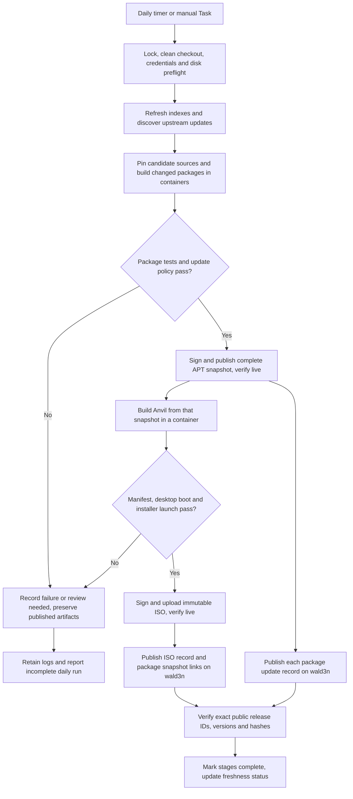
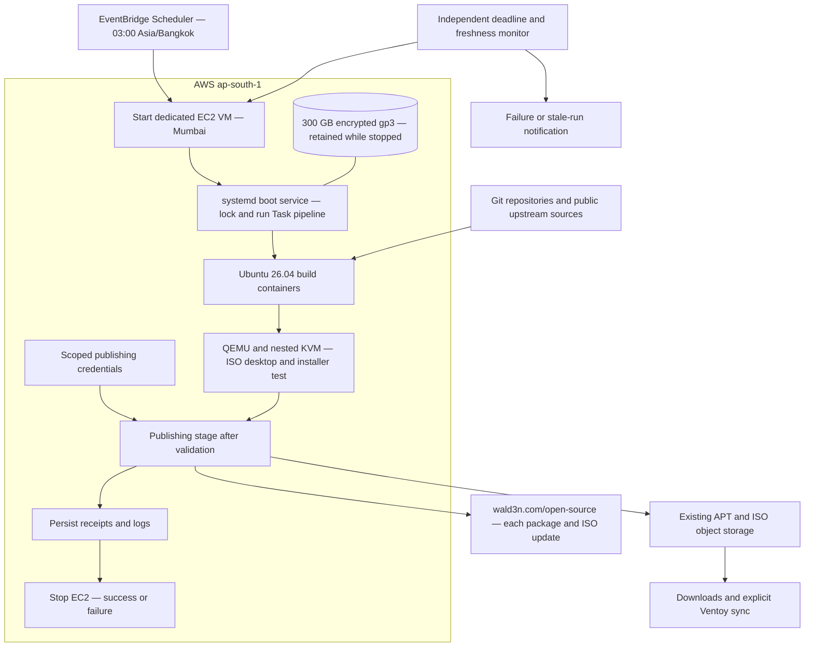
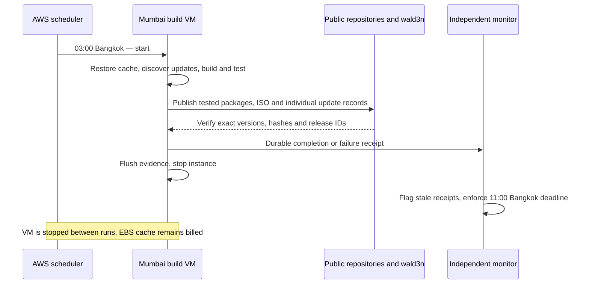

# Daily Foundry package and ISO updates

**Date:** 2026-11-15
**Status:** Proposal for Will’s review; scheduling and publication are not enabled by this document.

## Outcome

Check for updates every day, publish tested package updates, and produce a fresh Anvil ISO from the resulting repository snapshot. Publish a dated record of **every package and ISO update under https://wald3n.com/open-source**, with permanent links, downloads, checksums, change summaries and validation results. A run is complete only after the artifacts and their public update records are verified live.

Use container builds and independently runnable publishing commands. GitHub remains a Git remote; GitHub Actions is excluded. **Will clarified on 2026-11-15 that the home lab is not set up.** The earlier agreement to a lab build VM cannot be implemented there yet. Evaluate the AWS Mumbai option below for the first deployment; a dedicated home-lab VM and later Kubernetes remain migration targets. No AWS resources have been provisioned or spending authorized by this plan. The agreed daily time remains 03:00 Asia/Bangkok.

## Evidence and existing work

- [`scripts/refresh-distro.sh`](../../scripts/refresh-distro.sh) and `task distro-refresh` rebuild pinned Foundry packages and the ISO against current APT indexes, but deliberately stop before signing and publishing. Rebuilding a pinned version does not discover a new upstream release.
- [`Taskfile.yml`](../../Taskfile.yml) has ISO build, signing and upload tasks. Refactor their version allocation and cache checks for unattended runs: one version per run, external APT changes included in freshness decisions, no writes to Will’s active checkout.
- [`foundry-apt/scripts/publish-local.sh`](../../foundry-apt/scripts/publish-local.sh) supports signing but defaults to unsigned output without a key. Production automation must refuse missing signing credentials and avoid exposing a partial repository during replacement.
- [`foundry-iso/test/boot-smoke.sh`](../../foundry-iso/test/boot-smoke.sh) currently accepts a QEMU process surviving its timeout. That is insufficient evidence of a working desktop.
- Anvil 0.9.140 was built in a container, its PowerDevil version checked, and its KDE desktop observed in a UEFI VM. Its USB copy passed checksum verification. This is a manual baseline, not an automated daily service.
- The sibling `../wald3n.com/` already owns `src/data/open-source.json`, `scripts/open-source-sources.json`, `task open-source:refresh`, `task open-source:verify`, and `task open-source:publish`. Its Foundry source root is the canonical `../foundrylinux.org/foundry-apt/packages`.
- The site publisher uses an isolated checkout, commits, pushes, deploys and checks the live site. Its current live status checks focus on compiler manifest/graph hashes; extend them to package and ISO release records. Preserve the existing compiler dashboard.
- [`scripts/complete-package-publish.sh`](../../scripts/complete-package-publish.sh) currently checks package presence on the public page. Require exact versions, artifact hashes and release IDs; name presence alone cannot prove an update is live. Carry forward the [publication completion plan](2026-08-06-package-publish-pipeline-hardening.md).

## Daily schedule and update policy

Agreed schedule (Will, 2026-11-15): **03:00 Asia/Bangkok each day**, with an external AWS schedule for a stopped cloud VM, or a persistent systemd timer when an always-on lab host exists. Track missed runs and retry explicitly in either deployment. Lock the entire run, bound retries and runtime, and report a skipped overlapping run. Never mark a failed or missed run green.

| Input | Daily action | Publication gate |
|---|---|---|
| Ubuntu 26.04 packages | Refresh authenticated indexes and resolve current supported updates | Dependency resolution, installation and ISO validation |
| Foundry packages | Detect upstream releases; update source pins, checksums and Debian versions in reviewable commits | Package tests, source/license checks, install/upgrade tests; hold changes outside the approved automatic-update policy for review |
| Foundry patches | Reapply and test patches; detect upstream inclusion | Never silently discard a patch or assume a newer upstream fixes the issue |
| WorldFoundry packages | Consume the published repository and check dependency availability | Keep its independent publishing owner; report stale or unavailable dependencies |
| Anvil ISO | Build daily from the selected tested package snapshot, even if Foundry sources are unchanged | Embedded package manifest, UEFI desktop boot and installer launch |
| Atelier ISO | Explicit additional schedule after capacity is measured | Same gates; initially outside the daily Anvil scope |

Unchanged package binaries need not be rebuilt or republished. Record a successful “checked; no updates” result separately from a new package release. New upstream versions needing review remain visible as pending; do not claim everything is current while candidates are held. Define permitted unattended updates per package before enabling automatic promotion.

## Execution and publication flow



Package publication may succeed while an ISO fails. Publish those successful package records promptly and report the ISO failure separately. A website failure leaves publication incomplete; retry the site stage from durable receipts without rebuilding or republishing the same binaries.

## Public pages and review screens

Proposed URLs belong to the existing Astro site in `../wald3n.com/`. These are new routes to implement, not pages that already exist. Artifact bytes remain on the appropriate APT/ISO storage; the site provides the public release record and download links.

```text
/open-source                         Existing dashboard
  Foundry updates                    [View update history]
  Last check: 2026-11-16 03:00 +07:00
  Packages: published   ISO: testing   Website: current

/open-source/foundry                  Update history
  [All] [Packages] [ISOs]             [Search package or version]
  2026-11-16  PowerDevil <version>     Published  [Changes] [Downloads]
  2026-11-16  Anvil <version>          Published  [Packages] [Download ISO]
  Last successful ISO: <timestamp>    Daily check: healthy / stale

/open-source/foundry/releases/<release-id>
  Anvil <version> — published <timestamp with timezone>
  Changes: <human-readable summary>
  Validation: UEFI desktop PASS; installer launch PASS
  [Download ISO] [SHA256] [Signature] [Package manifest]
  Source commit: <link>   Package snapshot: <link>
  Related package updates: <version-specific links>
```

The history retains a record for each updated source package, including its binary packages and exact versions, and each ISO. A batch release may group entries but must not hide individual updates. Supply stable IDs and permalinks; use an additive schema-validated release ledger rather than overwriting history with today’s inventory. Include source/build revisions, artifact URLs and SHA256, UTC publication time, displayed timezone, upstream/Foundry change summaries, validation evidence and superseded-release links. An RSS/JSON feed can expose the same ledger without a separate source of truth.

```text
Operator review — proposed `task daily:status`
  Run <id>  Source <commit>  Mode: candidate / automatic
  Packages: 3 passed, 1 needs review
  ISO: waiting for package snapshot
  Public records: 3 verified, 0 pending
  [Inspect evidence] -> task daily:inspect RUN=<id>
  [Retry failed stage] -> task daily:retry RUN=<id> STAGE=site
  [Promote reviewed candidate] -> task daily:promote RUN=<id>
```

These Task names are proposed interfaces. Promotion operates on the exact tested manifest and refuses changed inputs. Routine runs follow the configured promotion policy; the review screen is for held candidates and failures.

## Implementation checklist

- [ ] Select and provision the initial AWS Mumbai build VM after cost review (home lab unavailable), with storage, network capacity and nested KVM for ISO boot tests; measure a complete Anvil run. Use the established container stacks and Ubuntu 26.04 where required. Resolve interactive `pkexec` steps through a narrowly scoped build service before scheduling.
- [ ] Add a Task include and a single resumable orchestration command with stage receipts, a lock, deadlines and bounded retries. Use isolated checkouts and pinned builder images; record all input revisions and resolved package versions.
- [ ] Add upstream discovery and reviewable pin/version updates. Define the unattended-update policy and dependency rebuild rules. Reuse verified cached outputs keyed by source, recipe and builder inputs.
- [ ] Make signed APT publication independently runnable outside Actions. Preserve complete package/source inventories and durable artifacts; upload content before metadata, use by-hash indexes or an equivalent consistent snapshot scheme, and verify from a fresh client. Never replace different bytes under the same package version.
- [ ] Make ISO versions unique per run and build from the verified package snapshot. Use published package inputs for release ISOs; prevent arbitrary stale `local-debs/` from overriding them.
- [ ] Replace the process-survival smoke criterion with an explicit guest desktop-ready check and installer-launch evidence. Keep the VM diskless/network-isolated where possible; collect screenshots and logs. Assert PowerDevil regression coverage and installer branding presence.
- [ ] Provision signing/upload credentials to the publishing service outside Git and logs. Validate credential availability in preflight; unsigned output cannot reach public channels.
- [ ] Publish ISO files and signatures under immutable names, verify remotely, then update the latest pointer. Preserve the previous working image if any stage fails.
- [ ] Extend the wald3n data model, history/detail pages and publisher with package/ISO records and exact-version live checks. Reuse its container development workflow and isolated publishing checkout; keep compiler updates independent enough that an unrelated compiler refresh cannot block Foundry history publication.
- [ ] Add durable pending-publication receipts and idempotent retries across repositories. Verify the exact ledger hash/release IDs through the deployed site before clearing completion markers.
- [ ] Add a freshness monitor independent of the build process: alert on failures, missed checks and no successful daily ISO for more than 36 hours. Select an existing authorized notification destination before enabling outbound messages. Show separate package-check, ISO and website timestamps.
- [ ] Install the 03:00 scheduler and missed-run handling, validate a manual full run, then observe two scheduled runs. Later migrate the same commands to lab Kubernetes jobs when that platform is ready.

## Validation and operational limits

Test discovery with a known new release; unchanged inputs; patch conflicts; failed package tests; missing signing keys; incomplete package inventory; unavailable upstreams; low disk; overlapping jobs; interrupted uploads; a VM stuck at the splash screen; and a website deployment that serves an old version. Each failure must preserve the previous published artifacts and retain a truthful pending/failed status. Confirm site retries do not duplicate release entries.

Success requires two consecutive scheduled runs, signed artifacts installable/downloadable from their public locations, matching ISO and repository package versions, real desktop/installer validation, and the exact package/ISO update records visible under `/open-source`. Exercise missed-run catch-up and the independent stale monitor. A schedule cannot guarantee a successful update during an upstream outage; it must make that outage visible.

Do not automatically install daily packages on Will’s laptop or write removable media as part of this job. Ventoy remains an explicit, checksum-verified sync using `../home-lab/Taskfile.distros.yml` and `home-lab/boot/foundry/`. Do not delete Docker images, caches or volumes. Choose and approve artifact retention separately; retain published release records even if an older downloadable artifact is eventually retired.

## AWS Mumbai option — first deployment candidate

**Next step (Will, 2026-11-15):** run the [cold/warm AWS spike](2026-11-15-aws-cold-warm-build-spike.md), retaining the disk for a second run later today. The four-hour daily case below is only a sensitivity example; replace it with measured timings before selecting a budget.

**Recommendation for review:** one On-Demand Linux `m7i.2xlarge` in **Mumbai (`ap-south-1`)**, started for the daily job and stopped afterwards. It provides 8 vCPUs and 32 GiB RAM. Start with 300 GB total encrypted gp3 storage (for example 40 GB OS + 260 GB build/cache). Measure peak disk and memory before final sizing. Stopped EC2 compute stops accruing instance hours; persistent disks continue to cost money. Do not assume a home registry or any other lab service is available.

AWS documents nested KVM support for M7i, so the ISO can boot inside this VM without renting a large bare-metal server. Explicitly enable nested virtualization, verify the region/account offering and `/dev/kvm`, then demonstrate a full desktop boot before accepting the runner. The public price list confirms a Mumbai price, not account capacity or a successful benchmark. The account Pricing API query had no available credentials in this session; costs below use AWS’s public catalogs. [Nested virtualization documentation](https://docs.aws.amazon.com/AWSEC2/latest/UserGuide/amazon-ec2-nested-virtualization.html).

### Architecture



Use an external schedule because a stopped VM cannot run its own timer. EventBridge can invoke EC2 StartInstances/StopInstances directly. A systemd service runs at boot, checks the run ledger and invokes the shared Task pipeline. Install a separate eight-hour deadline stop plus an external freshness check so a hung build cannot run indefinitely or hide its own failure. Set instance-initiated shutdown to **stop**, not terminate. The deadline is a cost guard, not a success signal; interrupted publication remains pending. [AWS start/stop scheduling guidance](https://repost.aws/knowledge-center/start-stop-lambda-eventbridge).



Provision with Terraform and the existing container workflow. Use SSM for administration, a public subnet with an automatically assigned public IPv4 address and a security group with no inbound access. Outbound access supplies APT, Git and Cloudflare. This avoids a dedicated NAT Gateway and its standing charges. Do not reserve an Elastic IP: its idle charge would continue when the VM stops. Keep the build host dedicated because live-build needs elevated container access.

Bootstrap the pinned standard container stacks without the home lab: export verified OCI images to accessible storage, restore and verify their digests on the runner, and retain them in its persistent cache. Count initial image upload, storage and cold-cache downloads separately. Keep signing/upload credentials out of source builds; fetch them only for the publishing stage using the instance role and a narrowly scoped secret policy. The full job, including site builds, stays runnable without Actions or the home registry.

### Costs checked on 2026-11-15

USD, before taxes and support charges. Linux On-Demand, shared tenancy, no Savings Plan, Reserved Instance, Spot discount or promotional credits assumed. Rates come from the AWS Mumbai EC2 catalog published 2026-11-14 and AWS transfer catalog; selected rows are retained in [the pricing evidence file](2026-11-15-daily-packages-and-iso-aws-rates.json).

| Component | Rate or assumption | Monthly cost at 4 hours/day |
|---|---|---:|
| `m7i.2xlarge` compute | $0.4242/hour × 120 hours | $50.90 |
| gp3 storage, retained all month | 300 GB × $0.0912/GB-month; baseline performance | $27.36 |
| Automatically assigned public IPv4 | $0.005/hour × 120 hours | $0.60 |
| AWS outbound uploads | Model 200 GB/month; $0.1093/GB beyond available shared free allowance | $10.93–21.86 |
| Scheduler, logs, secrets and monitoring | $5 planning allowance, not a quoted service bundle | $5.00 |
| Additional R2 Standard storage | Model 200 GB retained × $0.015/GB-month, no free storage credit assumed | $3.00 |
| **Illustrative total** | Existing site/domain charges excluded | **$97.79–108.72** |

The outbound scenario rounds each ISO to 5 GB × 30 days = 150 GB and allows another 50 GB for changed packages and other uploads. The low end assumes the account-wide 100 GB/month internet egress allowance is available; the high end assumes other workloads used it. More package uploads increase the bill. Initial bootstrapping and package rebuilds may exceed this model. Sources: [AWS Mumbai EC2/gp3 catalog](https://pricing.us-east-1.amazonaws.com/offers/v1.0/aws/AmazonEC2/current/ap-south-1/index.csv), [AWS transfer catalog](https://pricing.us-east-1.amazonaws.com/offers/v1.0/aws/AWSDataTransfer/current/index.csv), [EC2 egress allowance](https://aws.amazon.com/ec2/pricing/on-demand/), [IPv4 pricing](https://aws.amazon.com/vpc/pricing/).

| Runtime scenario | Compute hours/month | Compute alone | Total with the same storage/upload assumptions |
|---|---:|---:|---:|
| 2 hours/day | 60 | $25.45 | $72.04–82.97 |
| **4 hours/day — initial planning case** | **120** | **$50.90** | **$97.79–108.72** |
| 6 hours/day | 180 | $76.36 | $123.55–134.48 |
| Left running continuously | 730 | $309.67 | $359.61–370.54 |

Daily scenarios use 30 builds/month; the continuous comparison uses the conventional 730-hour month. These are sensitivity calculations, **not measured AWS build times**. Four hours is a budgeting assumption for incremental package work plus Anvil; rebuilding all large packages can take substantially longer. Each additional hour on every daily run adds about $12.88/month for compute and IPv4. Each additional 100 GB of persistent gp3 adds $9.12/month. A smaller `c7i.2xlarge` costs $0.357/hour but has only 16 GiB RAM; benchmark before choosing it for package builds. A `m7i.4xlarge` doubles memory/CPU and costs $0.8484/hour; it saves money only if its speedup justifies the higher rate.

EventBridge’s published allowance covers 14 million scheduler invocations monthly, far above this workload. Four Secrets Manager secrets at its example $0.40/secret-month would consume $1.60 of the $5 allowance; measure log ingestion and monitoring charges during the pilot. Additional snapshot backups, increased gp3 performance, paid support and any dedicated customer-managed KMS key are excluded and must be added if selected. [Scheduler pricing](https://aws.amazon.com/eventbridge/pricing/), [Secrets Manager pricing](https://aws.amazon.com/secrets-manager/pricing/).

Continue serving public binaries from the existing R2-backed APT/ISO storage. AWS still charges to upload there; R2 has no internet egress charge for subsequent public downloads. The $3 storage line models only 200 GB of added artifacts, not the existing account bill or unlimited history. Without pruning, 150 GB of new ISO data each month adds about $2.25 to the ongoing monthly R2 storage bill per month of retained history. Retention is still a review decision; do not silently delete old releases or Docker caches. R2 operations above the account’s free allowances are additional. [R2 pricing](https://developers.cloudflare.com/r2/pricing/).

### Deployment review screen and pilot

```text
Daily Foundry runner — proposed configuration
  Region:        Mumbai / ap-south-1
  Machine:       m7i.2xlarge — 8 vCPU / 32 GiB
  Persistent:    300 GB encrypted gp3
  Start:         03:00 Asia/Bangkok (01:30 Mumbai)
  Stop:          after completion/failure; independent 11:00 Bangkok deadline
  Estimate:      $98–109/month at 4 hours/day, before tax
  Publication:   existing APT/ISO storage + wald3n update history
  State:         NOT PROVISIONED

  [Review infrastructure diff] -> proposed task daily:infra:plan
  [Run one benchmark]          -> proposed task daily:pilot
  [Inspect cost and evidence]  -> proposed task daily:status
  [Enable schedule]           -> only after pilot and cost review
```

- [ ] Review the Terraform resource plan and AWS account/region; verify M7i nested virtualization support and capacity in the chosen AZ.
- [ ] Run one timed cold-cache build and one warm-cache daily cycle, capturing CPU, RAM, disk peaks, actual upload bytes and billable runtime. Verify the standard stacks are available without lab services.
- [ ] Test the successful stop, failed-build stop, external deadline stop and missed-run alarm. Configure a $150/month planning alert initially; AWS budget alerts are notifications, not a hard spending cap.
- [ ] Review the resulting monthly forecast before enabling the schedule. Initial provisioning and account credentials remain outstanding; this document creates no cloud resources.
- [ ] Keep the home-lab VM migration in the backlog until hardware/network/storage are actually configured; move the same Task pipeline after an equivalent validation run.

## Review decisions

- [x] Daily start time: 03:00 Asia/Bangkok; builds run in containers.
- [x] Will clarified that the home lab is not set up and requested the AWS alternative in a cheaper region, using Mumbai for this proposal.
- [ ] Review the AWS Mumbai budget, benchmark and deployment before provisioning; lab migration remains future work.
- [ ] Confirm per-package automatic promotion policy and initial Anvil-only daily scope.
- [ ] Confirm the proposed `/open-source/foundry` history and release-detail routes.
- [ ] Confirm signing service, notification destination and artifact retention policy before activation.

Reference: [systemd timer documentation](https://www.freedesktop.org/software/systemd/man/latest/systemd.timer.html) describes calendar scheduling and `Persistent=true` catch-up. The historical [daily APT audit plan](2026-06-13-audit-apt-repos-scheduled-daily-snapshots.md) uses Actions; this plan supersedes that scheduling approach for this work.

AI assistance: Codex CLI 0.169.0; model gpt-6-astra; reasoning effort medium, verified from session metadata.
